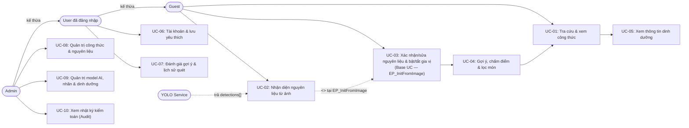

# Đặc tả Use Case — FoodVision AI

**Phiên bản:** `1.0.0` · **Trạng thái:** Chính thức (`Approved Baseline`) · **Đối chiếu:** [SRS](SRS.md), [UML Use Case Diagram](use-case-diagram.puml), [User Stories](user-stories.md), [Traceability Matrix](traceability-matrix.md)

---

## 1. Tác nhân và sơ đồ luồng tổng quan

Hệ thống gồm 3 tác nhân con người có quan hệ kế thừa quyền **`Admin --|> User --|> Guest`** (xem [ADR-011](../07-decisions/ADR-011-admin-role-inheritance.md)) và 1 tác nhân hệ thống nội bộ (**YOLO Service**):
- **Guest:** Tra cứu/xem công thức, xác nhận/nhập tay nguyên liệu qua tìm kiếm tiếng Việt & bật/tắt gia vị sẵn có (`UC-03`), tùy chọn tải ảnh nhận diện (`UC-02` mở rộng cho `UC-03` tại điểm mở rộng `EP_InitFromImage`), nhận gợi ý món có giải thích XAI (`UC-04`) và xem dinh dưỡng minh bạch (`UC-05`).
- **User (`User --|> Guest`):** Kế thừa toàn bộ Use Case của `Guest`, bổ sung quản lý tài khoản & lưu món yêu thích (`UC-06`), gửi đánh giá gợi ý & lưu/xem/xóa lịch sử quét (`UC-07`).
- **Admin (`Admin --|> User`):** Kế thừa toàn bộ Use Case của `User` (bao gồm đăng nhập/đăng xuất qua `UC-06` theo `FR-09a`), bổ sung quản trị công thức & nguyên liệu (`UC-08`), quản trị mô hình AI, ánh xạ nhãn & dinh dưỡng (`UC-09`), và xem nhật ký kiểm toán (`UC-10`).

Sơ đồ Mermaid dưới đây minh họa luồng tương tác nghiệp vụ tổng quan (bản ký pháp UML Use Case chuẩn nằm tại [`use-case-diagram.puml`](use-case-diagram.puml)):

---

## 2. Danh sách Use Case và bảng ánh xạ chuẩn hóa

### 2.1. Danh sách 10 Use Case (`UC-01`..`UC-10`)

| Mã UC | Tên Use Case | Tác nhân chính | FR liên quan | Mức ưu tiên |
|---|---|---|---|---|
| **UC-01** | Tra cứu và xem chi tiết công thức | Guest / User / Admin | `FR-01`, `FR-02` | P0 |
| **UC-02** | Nhận diện nguyên liệu từ ảnh (`<<extend>> UC-03`) | Guest / User / Admin, YOLO Service | `FR-03`, `FR-04`, `FR-18` | P0 |
| **UC-03** | Xác nhận, chỉnh sửa nguyên liệu (HITL) và bật/tắt gia vị sẵn có | Guest / User / Admin | `FR-05`, `FR-18` | P0 |
| **UC-04** | Gợi ý, chấm điểm và lọc món ăn | Guest / User / Admin | `FR-06`, `FR-07` | P0 |
| **UC-05** | Xem thông tin dinh dưỡng minh bạch | Guest / User / Admin | `FR-08` | P0 |
| **UC-06** | Quản lý phiên tài khoản và danh sách yêu thích | User / Admin | `FR-09a`, `FR-09b`, `FR-10` | P0 (`FR-09a`), P1 (`FR-09b`, `FR-10`) |
| **UC-07** | Đánh giá gợi ý và quản lý lịch sử nhận diện | User / Admin | `FR-11`, `FR-12` | P1 |
| **UC-08** | Quản trị công thức và nguyên liệu | Admin | `FR-13`, `FR-14` | P0 |
| **UC-09** | Quản trị mô hình AI, ánh xạ nhãn và dinh dưỡng | Admin | `FR-15`, `FR-16` | P0 (`FR-15`), P1 (`FR-16`) |
| **UC-10** | Tra cứu nhật ký kiểm toán (Audit Logs) | Admin | `FR-17` | P1 |

### 2.2. Bảng đối chiếu chuẩn hóa giữa sơ đồ `.puml` cũ (13 UC) và đặc tả mới (10 UC)

| Mã trong `.puml` cũ | Mã trong `use-cases.md` cũ | Mã chuẩn hóa mới | Quyết định thiết kế |
|---|---|---|---|
| `UC01`..`UC05` | `UC-01`..`UC-05` | **UC-01**..**UC-05** | Giữ nguyên mã; đảo quan hệ thành `UC-02 <<extend>> UC-03` tại điểm mở rộng `EP_InitFromImage` và bỏ `UC04 ..> UC03 <<include>>` để hỗ trợ cả luồng nhập tay độc lập (`FR-18`). |
| `UC06` (Đăng nhập) + `UC07` (Yêu thích) | `UC-06` | **UC-06** | Hợp nhất thành `UC-06` (Quản lý phiên tài khoản và danh sách yêu thích), bao phủ cả `FR-09a` (Admin login P0), `FR-09b` (User auth P1) và `FR-10`. |
| `UC08` (Phản hồi/lịch sử) | `UC-07` | **UC-07** | Giữ mã `UC-07` cho đánh giá gợi ý (`FR-11`) và quản lý lịch sử quét (`FR-12`). |
| `UC09` (Công thức) + `UC10` (Nguyên liệu) | `UC-08` | **UC-08** | Hợp nhất thành `UC-08` (Quản trị công thức và nguyên liệu — `FR-13`, `FR-14`). |
| `UC11` (Nhãn AI) + `UC12` (Dinh dưỡng) | `UC-09` (gộp cả Audit) | **UC-09** | Giữ `UC-09` cho Quản trị mô hình AI, ánh xạ nhãn (`FR-15`) và nhãn dinh dưỡng (`FR-16`). |
| `UC13` (Xem audit log) | Nằm chung trong `UC-09` | **UC-10** | Tách riêng thành `UC-10` (Tra cứu nhật ký kiểm toán — `FR-17`) vì là tác vụ tra cứu chỉ đọc độc lập. |

---

## 3. Đặc tả chi tiết từng Use Case

### UC-01 — Tra cứu và xem chi tiết công thức (`FR-01`, `FR-02`)

- **Tác nhân:** Guest / User / Admin.
- **Tiền điều kiện:** Hệ thống API hoạt động; có dữ liệu công thức ở trạng thái `published`.
- **Luồng chính:**
  1. Người dùng mở trang danh sách công thức hoặc nhấn vào một món ăn từ kết quả gợi ý (`UC-04`).
  2. Người dùng nhập từ khóa `q` (có dấu hoặc không dấu), chọn lọc `cuisine_code` (`VN`, `EU`, `US`) hoặc `max_total_minutes`; frontend gọi `GET /api/v1/recipes`.
  3. Backend trả danh sách phân trang các công thức `published` thỏa điều kiện (`items`, `total`, `limit`, `offset`).
  4. Người dùng chọn một món ăn; frontend gọi `GET /api/v1/recipes/{recipe_id}`.
  5. Backend trả chi tiết công thức (`RecipeDetail`): thời gian `prep_minutes`, `cook_minutes` (đã gồm thời gian ướp/chờ bắt buộc), `total_minutes`, danh sách nguyên liệu kèm trường `category` (giao diện tách riêng nhóm **Nguyên liệu chính** và khu vực nhắc nhở **"Gia vị cần chuẩn bị"** có `category = 'pantry'`), các bước hướng dẫn (`steps`), bằng chứng dinh dưỡng (`nutrition_evidence`) và thông tin nguồn/bản quyền. *(Ở Giai đoạn 3, nếu công thức có `base_servings` và `grams`, người dùng có thể đổi số khẩu phần $n_{\text{new}}$ để xem định lượng quy đổi tuyến tính kèm ghi chú gia vị/nhiệt phi tuyến).*
- **Luồng rẽ nhánh / Ngoại lệ:**
  - `E1 (Không có món khớp từ khóa/bộ lọc):` API trả `200 OK` với `items = []`, `total = 0`; giao diện hiển thị thông báo và nút xóa bộ lọc.
  - `E2 (Món không tồn tại hoặc đang draft/archived):` API `GET /api/v1/recipes/{recipe_id}` trả `404 RECIPE_NOT_FOUND`.
- **Hậu điều kiện:** Không làm thay đổi dữ liệu hệ thống.

### UC-03 — Xác nhận, chỉnh sửa nguyên liệu (HITL) và bật/tắt gia vị sẵn có (`FR-05`, `FR-18`) — *Base Use Case*

- **Tác nhân:** Guest / User / Admin.
- **Điểm mở rộng (Extension Point):** `EP_InitFromImage` — tại Bước 1, người dùng có thể chọn khởi tạo danh sách nguyên liệu từ ảnh chụp thông qua **UC-02** thay vì chỉ tìm kiếm/chọn thủ công.
- **Tiền điều kiện:** Danh mục nguyên liệu hoạt động (`GET /api/v1/ingredients` sẵn sàng).
- **Luồng chính:**
  1. Người dùng mở màn hình chuẩn bị nguyên liệu. *(Điểm mở rộng `EP_InitFromImage`: nếu người dùng chọn tải/chụp ảnh, hệ thống thực hiện **UC-02** rồi nạp danh sách `suggested_ingredients` và `detections` vào màn hình này, làm nổi bật các phát hiện có độ tin cậy thấp $\text{confidence} < \tau$ cần người dùng kiểm tra).*
  2. Giao diện tải danh mục nguyên liệu chuẩn từ `GET /api/v1/ingredients` (tách nhóm nguyên liệu chính `exclude_pantry=true` cho ô tìm kiếm và nhóm gia vị nền `category=pantry` cho thanh bật/tắt).
  3. Người dùng xem danh sách nguyên liệu chính hiện tại, thực hiện xóa nhãn sai, đổi sang nguyên liệu khác hoặc gõ tìm kiếm tiếng Việt (có dấu, không dấu như `"ca chua"`, từ đồng nghĩa vùng miền như `"đậu phụ"` ↔ `"đậu hũ"`, hoặc gõ nhầm nhẹ qua `pg_trgm`) để thêm nguyên liệu chính thủ công (`category != 'pantry'`). Hệ thống tự động gộp các phần tử trùng `ingredient_id`.
  4. Giao diện hiển thị thanh **"Gia vị sẵn có trong bếp"** (`category = 'pantry'`: muối, đường, nước mắm, dầu ăn, tiêu xay) ở trạng thái **mặc định bật (`checked`)**. Nếu bếp đang hết gia vị nào (ví dụ hết nước mắm), người dùng bỏ chọn gia vị đó để đưa vào danh sách `excluded_pantry_ids`.
  5. Người dùng nhấn nút **"Xác nhận & Tìm món ăn"** để chuyển sang **UC-04** với cặp dữ liệu `(ingredient_ids, excluded_pantry_ids)`.
- **Luồng rẽ nhánh / Ngoại lệ:**
  - `E1 (Danh sách nguyên liệu chính rỗng):` Nếu người dùng xóa hết nguyên liệu chính (`ingredient_ids = []`), giao diện khóa nút gửi và hiển thị hướng dẫn chọn ít nhất 1 nguyên liệu chính (dù thanh gia vị nền vẫn đang bật).
  - `E2 (Tham số truy vấn danh mục mâu thuẫn):` Nếu client gửi đồng thời `category=pantry&exclude_pantry=true` lên `GET /api/v1/ingredients`, backend trả `422 INVALID_QUERY_PARAMS`.
- **Hậu điều kiện:** Tạo được tập `ingredient_ids` (`category != 'pantry'`, `>= 1` phần tử) và `excluded_pantry_ids` (`category = 'pantry'`) hợp lệ cho **UC-04**.

### UC-02 — Nhận diện nguyên liệu từ ảnh (`FR-03`, `FR-04`, `FR-18`) — *`<<extend>>` UC-03 tại `EP_InitFromImage`*

- **Tác nhân:** Guest / User / Admin, YOLO Service.
- **Mối quan hệ UML:** Mở rộng (`<<extend>>`) cho **UC-03** tại điểm mở rộng `EP_InitFromImage` khi người dùng muốn trích xuất nguyên liệu tự động từ ảnh chụp.
- **Tiền điều kiện:** Người dùng đang ở Bước 1 của **UC-03** và chọn tải/chụp ảnh; nếu bật tùy chọn `save_history=true` thì phải có Bearer JWT hợp lệ của `User`/`Admin`.
- **Luồng mở rộng (Extension Flow):**
  1. Người dùng chọn một tệp ảnh (`JPEG`, `PNG` hoặc `WebP`, kích thước `<= 5 MiB`) và trạng thái `save_history` (mặc định `false`).
  2. Frontend kiểm tra sơ bộ định dạng/dung lượng và gửi `POST /api/v1/ai/detect` (`multipart/form-data`).
  3. Backend kiểm tra dung lượng, magic bytes, giải mã ảnh an toàn, **đọc cờ `EXIF Orientation` để xoay ảnh về đúng chiều hiển thị chuẩn và xóa sạch toàn bộ metadata `EXIF/GPS` trong bộ nhớ**.
  4. YOLO Service chạy suy luận với mô hình đang `active`; backend lọc theo `confidence_threshold`, chạy NMS, quy đổi tọa độ `bbox` chuẩn hóa `[0, 1]` trên ảnh đã xoay và ánh xạ `class_index -> ingredient_id` qua bảng `ai_labels`. *(Ở Giai đoạn 2 & 4, phát hiện có `confidence` dưới ngưỡng $\tau$ được gắn cảnh báo xác nhận HITL `Review(x) = 1` và có thể kèm danh sách ứng viên từ nhánh phụ CLIP trên vùng cắt nếu được bật).*
  5. Nếu `save_history=true` (và đã xác thực), backend tạo bản ghi `scan_sessions` và `scan_detections` trong DB (không lưu ảnh gốc).
  6. Backend trả `200 OK` gồm `scan_id` (`null` nếu không lưu), `model_version`, `detections[]` và `suggested_ingredients[]` (đã gộp trùng theo `ingredient_id`).
  7. Giao diện vẽ `bbox` lên ảnh đã xoay chuẩn và nạp `suggested_ingredients[]` quay về Bước 3 của **UC-03**.
- **Luồng rẽ nhánh / Ngoại lệ (tất cả đều cho phép quay về nhập tay tại UC-03):**
  - `E1 (Ảnh quá 5 MiB):` Trả `413 IMAGE_TOO_LARGE`.
  - `E2 (Sai định dạng MIME):` Trả `415 UNSUPPORTED_IMAGE_TYPE`.
  - `E3 (Tệp ảnh hỏng/giả mạo):` Trả `422 INVALID_IMAGE`.
  - `E4 (Guest gửi save_history=true):` Trả `401 UNAUTHORIZED`.
  - `E5 (Quá thời gian suy luận hoặc vượt giới hạn tốc độ):` Trả `504 INFERENCE_TIMEOUT` (hoặc `429 RATE_LIMITED`); giao diện hiển thị nút thử lại hoặc tiếp tục nhập tay ở **UC-03**.
  - `E6 (Chưa có model active):` Trả `503 MODEL_NOT_READY`; giao diện chuyển sang nhập tay ở **UC-03**.
  - `E7 (Không phát hiện được đối tượng nào — detections=[]):` Vẫn trả `200 OK` với mảng rỗng; giao diện thông báo và mời người dùng chọn nguyên liệu thủ công ở **UC-03** (`FR-18`).
- **Hậu điều kiện:** Tệp ảnh gốc và bộ đệm trong RAM được dọn sạch hoàn toàn ngay sau khi phản hồi.

### UC-04 — Gợi ý, chấm điểm và lọc món ăn (`FR-06`, `FR-07`)

- **Tác nhân:** Guest / User / Admin.
- **Tiền điều kiện:** Đã có danh sách `ingredient_ids` (`>= 1` nguyên liệu chính) và `excluded_pantry_ids` (từ **UC-03** hoặc truyền trực tiếp qua API).
- **Luồng chính:**
  1. Người dùng tùy chọn cấu hình bộ lọc cứng (`cuisine_codes`, `max_total_minutes`), ưu tiên mềm (`preferred_cuisine_codes`) và cờ `include_missing` (mặc định `true`).
  2. Frontend gửi `POST /api/v1/recommendations` kèm `ingredient_ids`, `excluded_pantry_ids` và `scan_id` (nếu có).
  3. Backend kiểm tra tính hợp lệ của toàn bộ UUID trong `ingredient_ids` (phải tồn tại, `is_active=true`, `category != 'pantry'`) và `excluded_pantry_ids` (phải tồn tại, `is_active=true`, `category = 'pantry'`). Nếu có `scan_id != null`, xác minh `scan_id` thuộc về người dùng hiện tại và lưu danh sách `ingredient_ids` vào bảng `scan_ingredients`.
  4. Backend lọc các công thức `published` thỏa `cuisine_codes`, `max_total_minutes` và có ít nhất 1 nguyên liệu chính khớp với `ingredient_ids` (`C > 0`). *(Ở cấu hình `Scoring v1.1` Giai đoạn 2, lọc cứng trước các món vi phạm dị ứng/thiết bị $\text{DietOK}/\text{EquipOK}$ sang `BLOCKED`).*
  5. Backend tính điểm và phân nhóm theo cấu hình đang áp dụng: ở MVP (`Scoring v1.0`), tính `E`, `C`, `T`, `P` và `S` (gia vị bắt buộc nằm trong `excluded_pantry_ids` tạo thành tập thiếu `M_pantry`, làm giảm `E`, `C` và chuyển món sang `"missing"`). *(Ở `Scoring v1.1` Giai đoạn 2–4, tính độ phủ có trọng số $w_{r,i}$, điểm đa tiêu chí MCDA 5 thành phần, xác suất cá nhân hóa Logistic Regression $p_{u,r}$ và tái xếp hạng đa dạng hóa MMR).*
  6. Backend xếp nhóm `availability = "ready"` lên trước nhóm `"missing"`, sắp xếp theo `score DESC`, số nguyên liệu bắt buộc thiếu `ASC`, `total_minutes ASC`, `recipe_id ASC` và trả về top `limit`.
  7. Người dùng xem danh sách kết quả kèm giải thích tiếng Việt (`explanation_vi`), điểm thành phần XAI và nhấn vào món ăn để mở **UC-01**.
- **Luồng rẽ nhánh / Ngoại lệ:**
  - `E1 (UUID không tồn tại, inactive hoặc sai nhóm pantry/main):` Trả `422 INVALID_INGREDIENTS`.
  - `E2 (scan_id không tồn tại hoặc thuộc người dùng khác):` Trả `404 SCAN_NOT_OWNED`.
  - `E3 (Không có công thức nào khớp):` Trả `200 OK` với `items = []`, `total = 0`; giao diện gợi ý bỏ bớt bộ lọc hoặc thêm nguyên liệu.
- **Hậu điều kiện:** Trả danh sách gợi ý minh bạch; cập nhật `scan_ingredients` nếu có `scan_id` hợp lệ.

### UC-05 — Xem thông tin dinh dưỡng minh bạch (`FR-08`)

- **Tác nhân:** Guest / User / Admin.
- **Tiền điều kiện:** Người dùng đang xem chi tiết công thức (**UC-01**) hoặc danh mục nhãn dinh dưỡng.
- **Luồng chính:**
  1. Ở Tầng 1 (`P0` — MVP), giao diện hiển thị danh sách nhóm chất dinh dưỡng định tính (`nutrition_evidence[]` từ `GET /api/v1/recipes/{recipe_id}` hoặc danh mục từ `GET /api/v1/nutrition-tags`).
  2. Mỗi nhãn hiển thị tên tiếng Việt, mô tả định tính, nguyên liệu mang nhóm chất đó và liên kết nguồn tham khảo (`source_urls`). *(Ở Tầng 2 `P1` — Giai đoạn 3, nếu toàn bộ nguyên liệu tính năng lượng của món đã có định lượng `grams` kiểm duyệt và ánh xạ `ingredient_nutrients`, giao diện hiển thị thêm bảng ước tính `kcal`, protein, fat, carb theo USDA FoodData Central trên khẩu phần).*
  3. Giao diện hiển thị hộp cảnh báo miễn trừ trách nhiệm bắt buộc (`BR-03`) về việc không suy diễn `kcal`/`gram` từ ảnh chụp và người dùng cần tự kiểm tra thành phần dị ứng thực phẩm.
- **Luồng rẽ nhánh / Ngoại lệ:**
  - `E1 (Công thức chưa có nguyên liệu nào được gán nhãn dinh dưỡng):` Hiển thị thông báo *"Chưa có thông tin dinh dưỡng được kiểm chứng cho các nguyên liệu của món này"*.
- **Hậu điều kiện:** Tuyệt đối không suy diễn số liệu định lượng khi thiếu khối lượng xác thực.

### UC-06 — Quản lý phiên tài khoản và danh sách yêu thích (`FR-09a`, `FR-09b`, `FR-10`)

- **Tác nhân:** User / Admin.
- **Tiền điều kiện:** Dịch vụ Supabase Auth và API hoạt động.
- **Luồng chính:**
  1. **Đăng ký / Đăng nhập / Khôi phục mật khẩu:** Người dùng đăng ký tài khoản mới (`FR-09b`), hoặc User/Admin đăng nhập (`FR-09a`/`FR-09b`) qua Supabase Auth SDK để nhận JWT access token; nếu quên mật khẩu, yêu cầu gửi liên kết đặt lại qua email (`resetPasswordForEmail`).
  2. **Lưu món yêu thích:** Trên màn hình công thức, người dùng nhấn lưu yêu thích; frontend gửi `POST /api/v1/favorites` với `{ "recipe_id" }`. Backend trả `201 Created` (nếu mới lưu) hoặc `200 OK` (nếu đã có sẵn — idempotent).
  3. **Xem và xóa yêu thích:** Người dùng mở danh sách yêu thích (`GET /api/v1/favorites`) hoặc bỏ yêu thích (`DELETE /api/v1/favorites/{recipe_id}` trả `204 No Content`).
  4. **Đăng xuất:** Người dùng nhấn đăng xuất; frontend gọi `supabase.auth.signOut({ scope: 'local' })` để xóa phiên trên thiết bị hiện tại và chuyển về chế độ Guest.
- **Luồng rẽ nhánh / Ngoại lệ:**
  - `E1 (Chưa đăng nhập hoặc JWT hết hạn):` Các API `/favorites` trả `401 UNAUTHORIZED`.
  - `E2 (Lưu yêu thích cho công thức không tồn tại hoặc chưa published):` Trả `404 RECIPE_NOT_FOUND`.
- **Hậu điều kiện:** Dữ liệu `favorites` được cô lập theo đúng `user_id` (đồng thời đóng vai trò tín hiệu dương $y=1$ cho mô-đun học sở thích Giai đoạn 4).

### UC-07 — Đánh giá gợi ý và quản lý lịch sử nhận diện (`FR-11`, `FR-12`)

- **Tác nhân:** User / Admin.
- **Tiền điều kiện:** Người dùng đã đăng nhập có Bearer JWT hợp lệ.
- **Luồng chính:**
  1. **Gửi đánh giá gợi ý (`POST /api/v1/feedback`):** Người dùng chọn điểm `rating` (`1..5`), nhập `note` tùy chọn (`<= 500` ký tự) cho một công thức `published`, kèm `scan_id` (nếu đánh giá từ một phiên quét đã lưu) hoặc `scan_id = null` (nếu duyệt tự do). Backend thực hiện **upsert** theo khóa `(user_id, recipe_id, scan_session_id)`: trả `201 Created` nếu tạo mới, hoặc `200 OK` (cập nhật `rating`, `note`, `updated_at`) nếu gửi lại trong cùng ngữ cảnh. *(Khi tổng hợp học cá nhân hóa Logistic Regression ở Giai đoạn 4, hệ thống lấy bản ghi có `updated_at` mới nhất trên mỗi cặp `(user_id, recipe_id)`).*
  2. **Xem lịch sử nhận diện:** Người dùng mở `GET /api/v1/scan-sessions` để xem danh sách các phiên quét đã chủ động lưu (`save_history=true`), và nhấn vào một phiên để xem chi tiết (`GET /api/v1/scan-sessions/{scan_id}`).
  3. **Xóa lịch sử nhận diện:** Người dùng nhấn xóa một phiên quét; **giao diện hiển thị hộp thoại xác nhận nêu rõ việc xóa phiên quét sẽ xóa luôn các đánh giá (`feedback`) đã gửi gắn với phiên quét đó**. Khi người dùng xác nhận, frontend gọi `DELETE /api/v1/scan-sessions/{scan_id}`; backend xóa bản ghi `scan_sessions` (kéo theo `ON DELETE CASCADE` cho `scan_detections`, `scan_ingredients` và các dòng `recommendation_feedback` của phiên đó) và trả `204 No Content`.
- **Luồng rẽ nhánh / Ngoại lệ:**
  - `E1 (Truy cập/xóa hoặc gửi feedback với scan_id không tồn tại hoặc thuộc người dùng khác):` Backend trả `404 SCAN_NOT_OWNED`.
  - `E2 (Điểm rating ngoài khoảng 1..5 hoặc note > 500 ký tự):` Trả `422 VALIDATION_ERROR`.
- **Hậu điều kiện:** Lịch sử quét và đánh giá được cập nhật/xóa an toàn, không bao giờ gây lỗi xung đột khóa duy nhất với các đánh giá có `scan_id = null`.

### UC-08 — Quản trị công thức và nguyên liệu (`FR-13`, `FR-14`)

- **Tác nhân:** Admin (`profiles.role = 'admin'`).
- **Tiền điều kiện:** Admin đã đăng nhập (`FR-09a`) và được server xác minh quyền `admin`.
- **Luồng chính:**
  1. **Quản lý nguyên liệu (`/api/v1/admin/ingredients`):** Admin tra cứu danh sách nguyên liệu (gồm cả `inactive`), tạo nguyên liệu mới (`category` thuộc `vegetable`, `protein`, `seafood`, `spice`, `pantry`, `other`) hoặc cập nhật nguyên liệu và danh sách tên đồng nghĩa (`aliases`, tự động sinh `normalized_alias` phục vụ `pg_trgm`).
  2. **Tạo và biên tập công thức (`/api/v1/admin/recipes`):** Admin tạo công thức ở trạng thái `draft`, cập nhật `prep_minutes`, `cook_minutes` (bao gồm cả thời gian ướp/chờ/hầm bắt buộc), nguyên liệu (kèm vai trò/trọng số/định lượng nếu có) và các bước nấu (`steps`). Nếu `sum(estimated_minutes) > prep_minutes + cook_minutes`, giao diện Admin hiển thị cảnh báo vàng để người biên tập rà soát.
  3. **Công bố hoặc sửa công thức đang công bố:** Admin gọi `PATCH /api/v1/admin/recipes/{id}/status` để chuyển sang `published` (hoặc gọi `PATCH /api/v1/admin/recipes/{id}` trên món đang `published`). Backend kiểm tra 4 điều kiện (`BR-01`, `BR-05`) và ghi nhận vào `audit_logs`.
- **Luồng rẽ nhánh / Ngoại lệ:**
  - `E1 (Tài khoản không phải Admin):` Trả `403 FORBIDDEN`.
  - `E2 (Trùng slug công thức hoặc nguyên liệu):` Trả `409 DUPLICATE_SLUG`.
  - `E3 (Vi phạm điều kiện công bố hoặc sửa món đang published):` Khi thiếu `steps`, thiếu nguyên liệu chính bắt buộc (`category != 'pantry'`), chứa nguyên liệu `is_active=false`, hoặc có 1 bước đơn lẻ với `estimated_minutes > prep_minutes + cook_minutes`, backend trả `400 RECIPE_NOT_PUBLISHABLE`.
  - `E4 (Tắt hoặc đổi category của nguyên liệu đang dùng):` Khi Admin đặt `is_active=false` hoặc đổi `category` của nguyên liệu đang nằm trong món `published` hoặc trong `ai_labels` của model `draft`/`active`, backend trả `400 INGREDIENT_IN_USE`.
- **Hậu điều kiện:** Dữ liệu công thức và nguyên liệu luôn thỏa bất biến toàn vẹn; sinh bản ghi `audit_logs`.

### UC-09 — Quản trị mô hình AI, ánh xạ nhãn và dinh dưỡng (`FR-15`, `FR-16`)

- **Tác nhân:** Admin (`profiles.role = 'admin'`).
- **Tiền điều kiện:** Admin đã đăng nhập và có quyền `admin`.
- **Luồng chính:**
  1. **Đăng ký model mới (`POST /api/v1/admin/ai-models`):** Admin đăng ký metadata phiên bản model ở trạng thái `draft` (`version`, `family`, `dataset_version`, `artifact_ref`, `confidence_threshold`, ngưỡng cảnh báo HITL `review_threshold`).
  2. **Cấu hình ánh xạ nhãn (`POST`/`PATCH /api/v1/admin/ai-labels`):** Trên model `draft`, Admin gán từng `class_index` vào `ingredient_id` của nguyên liệu thực phẩm/gia vị tươi đang hoạt động (`is_active=true`, `category != 'pantry'`).
  3. **Kích hoạt hoặc Rollback model (`PATCH /api/v1/admin/ai-models/{id}/status`):** Admin chuyển một model từ `draft -> active` (hoặc **rollback từ `archived -> active`**). Backend kiểm tra toàn bộ lớp đã được ánh xạ và mọi nguyên liệu được ánh xạ hiện vẫn đang `is_active=true` và `category != 'pantry'`; nếu hợp lệ, tự động chuyển model `active` cũ sang `archived` trong cùng giao dịch.
  4. **Quản trị nhãn dinh dưỡng (`/api/v1/admin/nutrition-tags`, `PUT /api/v1/admin/ingredients/{id}/nutrition-tags`):** Admin tạo/sửa nhãn dinh dưỡng định tính và gán cho nguyên liệu kèm đường dẫn nguồn tham khảo `source_url` bắt buộc.
- **Luồng rẽ nhánh / Ngoại lệ:**
  - `E1 (Trùng version model):` Trả `409 DUPLICATE_MODEL_VERSION`.
  - `E2 (Sửa ánh xạ nhãn của model active hoặc archived):` Trả `400 MODEL_IMMUTABLE`.
  - `E3 (Ánh xạ nhãn vào nguyên liệu pantry hoặc inactive):` Trả `400 INVALID_LABEL_MAPPING`.
  - `E4 (Kích hoạt/rollback model thiếu ánh xạ hoặc chứa nguyên liệu đã bị tắt/đổi sang pantry):` Trả `400 MODEL_NOT_ACTIVATABLE` (`unmapped_class_indices` / `invalid_mapped_class_indices`).
  - `E5 (Gán nhãn dinh dưỡng thiếu source_url hoặc URL không hợp lệ):` Trả `422 VALIDATION_ERROR`.
- **Hậu điều kiện:** Đảm bảo chỉ có duy nhất 1 model `active` hợp lệ tại mọi thời điểm; sinh bản ghi `audit_logs`.

### UC-10 — Tra cứu nhật ký kiểm toán (`FR-17`)

- **Tác nhân:** Admin (`profiles.role = 'admin'`).
- **Tiền điều kiện:** Admin đã đăng nhập và có quyền `admin`.
- **Luồng chính:**
  1. Admin mở màn hình nhật ký hệ thống; frontend gọi `GET /api/v1/admin/audit-logs?limit=20&offset=0`.
  2. Backend trả danh sách bản ghi kiểm toán sắp xếp theo `created_at DESC`, gồm `id`, `actor_id`, `action`, `entity_type`, `entity_id`, `created_at` (không chứa token/secret).
- **Luồng rẽ nhánh / Ngoại lệ:**
  - `E1 (Người dùng thường gọi API):` Trả `403 FORBIDDEN`.
- **Hậu điều kiện:** Không làm thay đổi dữ liệu hệ thống (chỉ đọc).

---

## 4. Tiêu chí hoàn thành Use Case

- Khách (`Guest`) đi trọn hành trình `UC-03` (kèm hoặc không kèm `UC-02`) → `UC-04` → `UC-01` → `UC-05` mà không cần đăng nhập.
- Kịch bản ảnh không phát hiện được đối tượng (`detections = []`) hoặc lỗi `503`/`504` luôn dẫn người dùng về bước nhập tay và tìm kiếm tiếng Việt tại `UC-03` (`FR-18`).
- Người dùng A không thể đọc, sửa hoặc xóa `favorites`, `scan_sessions` hay dùng `scan_id` của người dùng B (`404 SCAN_NOT_OWNED`).
- Tài khoản `Admin` kế thừa quyền `User` (`Admin --|> User`), và mọi điều kiện chặn `400` (`RECIPE_NOT_PUBLISHABLE`, `INGREDIENT_IN_USE`, `MODEL_NOT_ACTIVATABLE`, `INVALID_LABEL_MAPPING`, `MODEL_IMMUTABLE`) hoạt động đúng hợp đồng.
