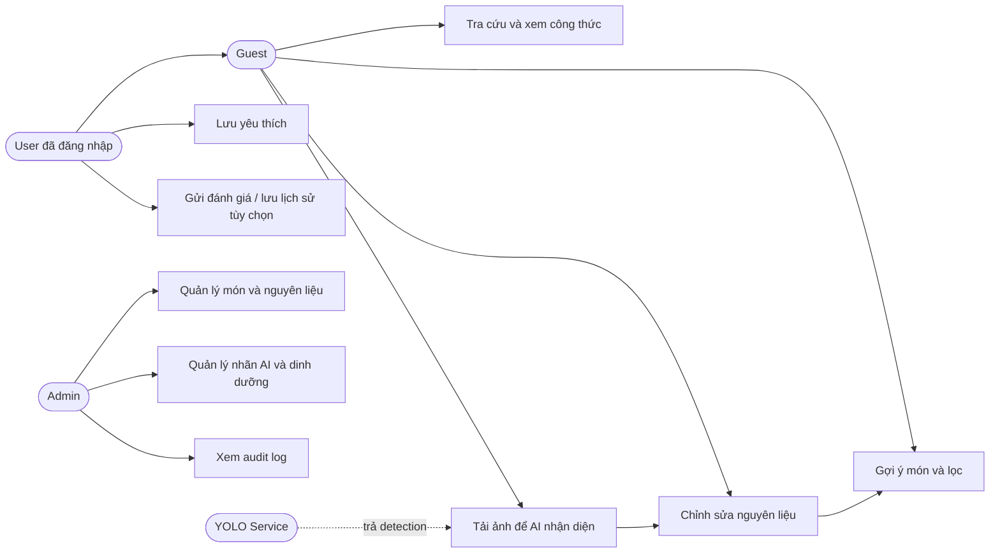

# Use Case — FoodVision AI

**Trạng thái:** Đề xuất · **Đối chiếu:** [SRS](SRS.md), [User Stories](user-stories.md)

## 1. Tác nhân và sơ đồ luồng tổng quan

Sơ đồ Mermaid thể hiện các tương tác ở mức chức năng (không thay thế ký pháp UML chính thức). Bản ký pháp UML Use Case chuẩn nằm ở [use-case-diagram.puml](use-case-diagram.puml) để render bằng PlantUML.

## 2. Danh sách Use Case

| ID | Tên | Tác nhân | FR liên quan |
|---|---|---|---|
| UC-01 | Xem/tìm công thức | Guest/User | FR-01, FR-02 |
| UC-02 | Nhận diện nguyên liệu từ ảnh | Guest/User, AI | FR-03, FR-04, FR-18 |
| UC-03 | Xác nhận/chỉnh sửa nguyên liệu | Guest/User | FR-05 |
| UC-04 | Gợi ý và lọc món | Guest/User | FR-06, FR-07 |
| UC-05 | Xem thông tin dinh dưỡng định tính | Guest/User | FR-08 |
| UC-06 | Đăng nhập và lưu yêu thích | User | FR-09, FR-10 |
| UC-07 | Phản hồi, lưu/xem/xóa lịch sử | User | FR-11, FR-12 |
| UC-08 | Quản trị công thức/nguyên liệu | Admin | FR-13, FR-14 |
| UC-09 | Quản trị nhãn AI/dinh dưỡng/audit | Admin | FR-15, FR-16, FR-17 |

## 3. Các luồng chi tiết

### UC-02 — Nhận diện nguyên liệu

- **Tiền điều kiện:** trình duyệt có ảnh; API và AI sẵn sàng. Không yêu cầu đăng nhập nếu không lưu lịch sử.
- **Luồng chính:** (1) người dùng chọn ảnh; (2) Frontend kiểm tra định dạng/dung lượng sơ bộ; (3) gửi `POST /ai/detect`; (4) Backend xác thực nội dung ảnh và chuẩn hóa; (5) YOLO nhận diện, ánh xạ nhãn theo phiên bản; (6) trả list detection và suggested ingredients; (7) Frontend hiển thị và chuyển UC-03.
- **Ngoại lệ:** E1 ảnh >5 MB/không hỗ trợ → HTTP 413/415; E2 ảnh hỏng → HTTP 422; E3 mô hình lỗi → HTTP 503; E4 không phát hiện được vật thể → 200 với danh sách rỗng, cho nhập thủ công.
- **Hậu điều kiện:** nguyên liệu gợi ý chỉ nằm trên client nếu `save_history=false`; ảnh gốc không được lưu.

### UC-03 — Xác nhận nguyên liệu

- **Tiền điều kiện:** có danh sách AI hoặc nhập tay.
- **Luồng chính:** (1) xem bounding box/nhãn, (2) xóa nhãn sai, sửa thành nguyên liệu chuẩn hoặc thêm thủ công, (3) gộp các nhãn trùng `ingredient_id`, (4) xác nhận danh sách cuối.
- **Ngoại lệ:** dữ liệu rỗng → không được gọi API recommend, UI hướng dẫn thêm ít nhất 1 nguyên liệu.
- **Hậu điều kiện:** danh sách `ingredient_ids` là nguồn duy nhất cho UC-04.

### UC-04 — Gợi ý món

- **Tiền điều kiện:** ít nhất 1 `ingredient_id` hợp lệ.
- **Luồng chính:** (1) chọn ẩm thực và thời gian tùy chọn; (2) gọi `POST /recommendations`; (3) Backend lấy recipe published, lọc thời gian/ẩm thực; (4) tính C/E/T/P, chia nhóm ready/missing và xếp hạng; (5) hiển thị điểm, lý do, nguyên liệu còn thiếu; (6) nhấn món để UC-01 xem chi tiết.
- **Ngoại lệ:** không có công thức → 200 với `items=[]` + thông điệp điều chỉnh bộ lọc; ID nguyên liệu không tồn tại → 422.
- **Hậu điều kiện:** không tự động ghi khẩu phần/calories.

### UC-06 — Đăng nhập và yêu thích

- **Tiền điều kiện:** Supabase Auth khả dụng, tài khoản hợp lệ.
- **Luồng chính:** (1) user đăng nhập trực tiếp qua Supabase Auth, (2) Frontend giữ access token theo SDK, (3) API favorites xác minh JWT, (4) thêm/xóa món hợp lệ, (5) chỉ trả danh sách của user hiện tại.
- **Ngoại lệ:** token hết hạn → 401; recipe chưa công bố → 404; đã tồn tại → thao tác idempotent, không tạo bản ghi trùng.

### UC-08 — Quản trị nội dung

- **Tiền điều kiện:** token của tài khoản có quyền `admin` được xác minh từ phía server.
- **Luồng chính:** (1) admin tạo công thức dạng draft, (2) cập nhật ingredients, steps, thời gian, nguồn; (3) backend validate; (4) công bố nếu đủ trường bắt buộc; (5) ghi audit log.
- **Ngoại lệ:** user thường → 403; không có nguyên liệu bắt buộc/bước nấu → 422; tên/slug trùng → 409.

## 4. Tiêu chí hoàn thành

- Có thể đi trọn hành trình UC-02 → UC-03 → UC-04 → UC-01 mà không đăng nhập.
- Kịch bản không nhận diện được nguyên liệu vẫn dẫn tới nhập tay (FR-18).
- Người dùng A không xem/ghi đè favorites hoặc scan history của người B.
- Không tài khoản Guest/User nào truy cập được endpoint Admin.
