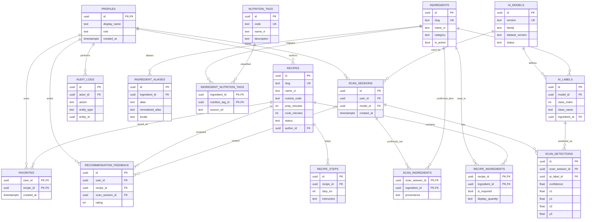

# Thiết kế Database và ERD

**Phiên bản:** 1.0.0 · **DB:** PostgreSQL (Supabase) · **Trạng thái:** Đề xuất

## 1. Sơ đồ ERD

Sơ đồ mô tả 16 bảng nghiệp vụ của MVP + P1, mối quan hệ PK/FK và bảng nối N–N. Xem bản nguồn tại [erd.mmd](erd.mmd).

## 2. Nguyên tắc mô hình hóa

1. `ingredients.id` là khóa UUID ổn định, **không dùng tên nguyên liệu hoặc chỉ số class YOLO làm khóa nghiệp vụ**.
2. `ai_labels` thuộc một `ai_models` cụ thể: `(model_id, class_index)` là duy nhất. Khi thay model, class_index có thể đổi; luôn ánh xạ lại model-label → ingredient.
3. `recipe_ingredients` là bảng nối N–N giữa món và nguyên liệu, có `is_required` để phân biệt thiếu thành phần chính hay phụ.
4. `recipe_steps` chứa các bước nấu có thứ tự `(recipe_id, step_no)` duy nhất.
5. `total_minutes` tính bằng `prep_minutes + cook_minutes` trong API/DB query, **không lưu cột tổng lặp lại**.
6. `nutrition_tags` là **mô tả định tính** được gắn với nguyên liệu qua `ingredient_nutrition_tags`, không có trường kcal/g nếu thiếu khối lượng xác thực.
7. `scan_sessions`, `scan_detections`, `scan_ingredients` **chỉ sinh bản ghi khi User đã đăng nhập và bật lưu lịch sử**; không lưu ảnh gốc ở MVP.
8. `favorites` và `recommendation_feedback` luôn thuộc user hiện tại; `audit_logs` chỉ server được tạo, client không tự ghi.

## 3. Ràng buộc then chốt

| Bảng | Ràng buộc cần áp dụng trong migration |
|---|---|
| `ingredients` | UNIQUE(slug), CHECK(slug không rỗng), `is_active DEFAULT true` |
| `ingredient_aliases` | UNIQUE(ingredient_id, normalized_alias, locale), FK ON DELETE CASCADE |
| `ai_models` | UNIQUE(version); status trong `draft`, `active`, `archived`; chỉ **một** model `active` (unique partial index); mapping của model active/archived không được sửa tại chỗ |
| `ai_labels` | UNIQUE(model_id, class_index); FK model và ingredient |
| `recipes` | UNIQUE(slug); prep/cook ≥0, bắt buộc có bước + required ingredient mới được published |
| `recipe_ingredients` | PK(recipe_id, ingredient_id); `is_required` không null |
| `recipe_steps` | UNIQUE(recipe_id, step_no), step_no ≥1 |
| `ingredient_nutrition_tags` | PK(ingredient_id, nutrition_tag_id); source_url bắt buộc khi công bố |
| `scan_detections` | 0≤confidence≤1; 0≤x1<x2≤1 và 0≤y1<y2≤1 |
| `scan_ingredients` | PK(scan_session_id, ingredient_id), provenance `ai/manual/corrected` |
| `favorites` | PK(user_id, recipe_id) ngăn trùng |
| `recommendation_feedback` | CHECK(rating between 1 and 5) |
| `profiles` | `id REFERENCES auth.users(id)`; role `user/admin` nhưng user thường không được tự sửa role |

**Quy tắc công bố recipe cần enforce trong API transaction**; CHECK SQL đơn bảng không đủ để đếm dòng con ở `recipe_ingredients` / `recipe_steps`. Migrations cần transaction, kiểm tra điều kiện trước khi chuyển trạng thái.

## 4. Index gợi ý

- `recipes(status, cuisine_code)`; `recipes(status, prep_minutes, cook_minutes)` hoặc expression index `status,(prep_minutes+cook_minutes)` tùy thống kê truy vấn.
- `recipe_ingredients(ingredient_id, recipe_id)` ngoài composite PK.
- `recipe_steps(recipe_id, step_no)` UNIQUE.
- `ai_labels(model_id, class_index)` UNIQUE.
- `ingredient_aliases(locale, normalized_alias)` hỗ trợ tìm kiếm.
- `scan_sessions(user_id, created_at DESC)`; `audit_logs(created_at DESC, actor_id)`.
- `favorites(user_id, created_at DESC)` nếu cần sắp xếp gần nhất.

Chỉ thêm index theo kết quả `EXPLAIN ANALYZE` và dữ liệu thực, không coi tất cả đều bắt buộc ngay.

## 5. Luồng cập nhật dữ liệu

- **Admin tạo món:** tạo recipe `draft` → thêm `recipe_ingredients`, `recipe_steps` → validate → chuyển `published` → audit.
- **Admin cập nhật nhãn AI:** chọn model version → ánh xạ class index sang mã nguyên liệu chuẩn; không thay ID nguyên liệu có sẵn để tránh lỗi lịch sử.
- **User nhận diện:** dự đoán trong request và không persist ảnh gốc; file tạm phải dọn sạch. Nếu bật `save_history=true`, insert scan_session + raw detections; sau khi request recommendations xác nhận danh sách, cập nhật `scan_ingredients` nếu scan thuộc chính user đó.
- **Xóa tài khoản:** cần có luồng xóa `scan_sessions` của chính User (FK detections/ingredients ON DELETE CASCADE, feedback.scan_session_id ON DELETE SET NULL), và xóa dữ liệu cá nhân favorites/feedback theo chính sách; audit nghiệp vụ có thể cần loại bỏ định danh.

## 6. Quyền dữ liệu

| Nhóm | Guest | User | Admin |
|---|---|---|---|
| Published recipes/ingredients/tags | Read | Read | Read/Write qua Backend |
| Draft/archived recipes | Không | Không | Read/Write qua Backend |
| Favorites | Không | Chỉ chính mình | Không xem user khác mặc định |
| Scan history | Không | Chỉ chính mình (có consent) | Không xem user khác mặc định |
| Admin audit | Không | Không | Read có kiểm soát |

Phải kết hợp **GRANT/REVOKE và RLS** khi dùng Data API; backend dùng service-role (nếu có) phải tự enforce quyền. Chi tiết ở [security-and-deployment.md](security-and-deployment.md).
