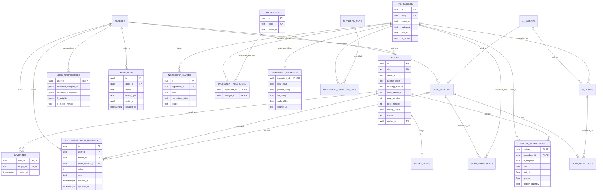

# Thiết kế Database, Cơ sở Tri thức và Tìm kiếm Tiếng Việt

**Phiên bản:** `1.0.0` · **DB:** PostgreSQL >= 15 (Supabase) · **Trạng thái:** Chính thức (`Approved Baseline`)

## 1. Cơ sở biểu diễn tri thức nguyên liệu – món ăn (Thành phần 03)

Hệ thống biểu diễn tri thức bằng mô hình quan hệ chuẩn hóa kết hợp tập luật suy luận ở tầng ứng dụng. Cần phân biệt rõ **CSDL quan hệ có cấu trúc** với **ontology tự suy diễn (OWL/RDF reasoner)**: PostgreSQL lưu trữ dữ kiện chuẩn xác và toàn vẹn tham chiếu để tầng Rule-based Reasoning (Thành phần 04) thực thi suy luận 3 trạng thái và kiểm tra ràng buộc.

Về mặt toán học, quan hệ xuất hiện cơ bản giữa nguyên liệu $i$ và công thức $j$ tương ứng ma trận nhị phân:

\[
M_{ij} = \begin{cases} 1, & \text{nếu nguyên liệu } i \text{ xuất hiện trong công thức } j \\ 0, & \text{ngược lại} \end{cases}
\]

Để phục vụ cả hợp đồng cốt lõi MVP (`Scoring v1.0`) lẫn lộ trình nâng cấp thông minh (`Scoring v1.1` — suy luận 3 trạng thái Thành phần 04, độ phủ có trọng số Thành phần 05, cá nhân hóa Thành phần 08, quy đổi khẩu phần Thành phần 10 và ước tính dinh dưỡng USDA Thành phần 11), bảng nối `recipe_ingredients` và các bảng vệ tinh mở rộng $M_{ij}$ bằng:

- **Phân tách nguyên liệu chính và gia vị nền (`pantry`):** `ingredients.category = 'pantry'` tách muối, đường, nước mắm, dầu ăn... khỏi tập nguyên liệu chính nhận diện qua ảnh; người dùng có thể báo hết gia vị qua `excluded_pantry_ids` (xem [ADR-008](../07-decisions/ADR-008-pantry-ingredients-handling.md)).
- **Vai trò & trọng số theo từng món** (`is_required`, `role`, `weight` $w_{r,i} > 0$).
- **Định lượng chuẩn** (`grams` phần ăn được ứng với `base_servings` của món, dùng cho quy đổi khẩu phần và dinh dưỡng Tầng 2 USDA).
- **Ràng buộc an toàn & chế biến** (`allergens` / `ingredient_allergens`, `required_equipment`, `cooking_method`, `quality_score`).

## 2. Sơ đồ ERD

Sơ đồ gồm **16 bảng cốt lõi của MVP** (tương thích hoàn toàn với [erd.mmd](erd.mmd)) cùng **4 bảng mở rộng Giai đoạn 2–4** (`ALLERGENS`, `INGREDIENT_ALLERGENS`, `INGREDIENT_NUTRIENTS`, `USER_PREFERENCES`) phục vụ lọc dị ứng, dinh dưỡng định lượng USDA và hồ sơ sở thích cá nhân hóa:



*(Chi tiết toàn bộ cột và kiểu dữ liệu của `PROFILES`, `AI_MODELS`, `AI_LABELS`, `RECIPE_STEPS`, `NUTRITION_TAGS`, `INGREDIENT_NUTRITION_TAGS`, `SCAN_SESSIONS`, `SCAN_DETECTIONS`, `SCAN_INGREDIENTS` cùng các bảng trên được định nghĩa tại [data-dictionary.md](data-dictionary.md)).*

## 3. Thiết kế tìm kiếm nguyên liệu tiếng Việt với `pg_trgm` (Thành phần 13)

Khi YOLO không nhận diện được nguyên liệu (ngoài phạm vi lớp học, bị che khuất) hoặc người dùng gõ thêm nguyên liệu sẵn có trong bếp, hệ thống hỗ trợ tìm kiếm tiếng Việt chịu lỗi gõ nhẹ, không dấu và từ đồng nghĩa vùng miền (như `"đậu hũ"` ↔ `"đậu phụ"`):

### 3.1. Chuẩn hóa chuỗi & Chỉ mục PostgreSQL

Hàm chuẩn hóa $\text{Norm}(s)$ ở Python/SQL đưa chuỗi về chữ thường (`casefold`), đổi `đ -> d`, chuẩn hóa Unicode `NFD` và loại bỏ dấu thanh (`Mn`), lưu sẵn vào cột `ingredient_aliases.normalized_alias`:

```sql
CREATE EXTENSION IF NOT EXISTS unaccent;
CREATE EXTENSION IF NOT EXISTS pg_trgm;

CREATE INDEX idx_alias_trgm
ON ingredient_aliases
USING GIN (normalized_alias gin_trgm_ops);
```

### 3.2. Thứ tự ưu tiên truy vấn 4 bước

Với truy vấn đầu vào $q$, hàm tương đồng $\text{Score}(q, a) = \text{Similarity}(\text{Norm}(q), \text{Norm}(a))$ trên tập nguyên liệu đang hoạt động (`ingredients.is_active = true`) được thực thi theo thứ tự ưu tiên:

1. Khớp chính xác mã `slug` hoặc `alias` có dấu.
2. Khớp chính xác chuỗi đã chuẩn hóa `normalized_alias = Norm(q)` (ví dụ `"ca chua"` → `tomato`, `"dau phu"` → `tofu`).
3. Tìm gần đúng bằng toán tử tam tự `pg_trgm` (`similarity(normalized_alias, Norm(q)) >= threshold`) cho trường hợp gõ nhầm nhẹ.
4. Nếu chỉ khớp gần đúng dưới ngưỡng chắc chắn (hoặc có nhiều nguyên liệu ứng viên đồng hạng), trả danh sách gợi ý để người dùng chọn trực tiếp trên UI autocomplete — **không tự động ánh xạ ngầm từ truy vấn mơ hồ sang mã nguyên liệu chuẩn**, đặc biệt để tránh sai sót khi kiểm tra dị ứng ở Giai đoạn 2.

## 4. Nguyên tắc mô hình hóa và ràng buộc toàn vẹn

1. `ingredients.id` là khóa UUID ổn định, **không dùng tên nguyên liệu hoặc chỉ số `class_index` của YOLO làm khóa nghiệp vụ**. Hệ thống không có endpoint xóa cứng (`DELETE`) đối với `ingredients` và `recipes`; chỉ hỗ trợ xóa mềm/lưu trữ (`ingredients.is_active = false`, `recipes.status = 'archived'`).
2. `ai_labels` thuộc một `ai_models` cụ thể: `(model_id, class_index)` là duy nhất. Khi thay model, `class_index` có thể đổi; luôn ánh xạ lại `model-label → ingredient` (chỉ cho phép trỏ tới nguyên liệu hoạt động không thuộc nhóm gia vị nền `pantry`).
3. `recipe_ingredients` là bảng nối N–N giữa món và nguyên liệu, có `is_required` để phân biệt thành phần bắt buộc hay tùy chọn, đồng thời mở rộng `role` (`primary` / `essential` / `secondary`), `weight` ($w_{r,i} > 0$, mặc định `1.00`) cho độ phủ có trọng số và `grams` (nullable) cho quy đổi khẩu phần & dinh dưỡng USDA. Nguyên liệu thuộc `category = 'pantry'` được dùng để hiển thị và kiểm tra loại trừ qua `excluded_pantry_ids`, không làm phồng điểm độ phủ khi sẵn có (xem [ADR-008](../07-decisions/ADR-008-pantry-ingredients-handling.md)).
4. `recipe_steps` chứa các bước nấu có thứ tự `(recipe_id, step_no)` duy nhất.
5. `total_minutes` tính bằng `prep_minutes + cook_minutes` trong API/DB query (trong đó `cook_minutes` bao gồm cả thời gian ướp/ủ/chờ bắt buộc theo [ADR-009](../07-decisions/ADR-009-cooking-and-waiting-time.md)), **không lưu cột tổng lặp lại**.
6. **Dinh dưỡng hai tầng & Truy vết dị ứng chuẩn xác:** ở MVP (`P0`), `nutrition_tags` là mô tả định tính gắn với nguyên liệu qua `ingredient_nutrition_tags`, không hiển thị kcal/g khi thiếu khối lượng xác thực. Ở Giai đoạn 3 (`P1`), `ingredient_nutrients` lưu hàm lượng trên $100\text{ g}$ từ USDA FoodData Central chỉ dùng khi có `grams` kiểm duyệt/người dùng nhập (xem [ADR-004](../07-decisions/ADR-004-nutrition.md)). Ở Giai đoạn 2, tác nhân dị ứng được gắn ở mức nguyên liệu (`ingredient_allergens`) để kiểm tra $\text{DietOK}(r, u)$ dựa trên thành phần đã kiểm duyệt chứ không dò từ khóa tên món.
7. `scan_sessions`, `scan_detections`, `scan_ingredients` **chỉ sinh bản ghi khi User đã đăng nhập và chủ động bật lưu lịch sử (`save_history = true`)**; không lưu ảnh gốc ở MVP.
8. `favorites`, `recommendation_feedback` và `user_preferences` luôn thuộc user hiện tại; `audit_logs` chỉ server được tạo, client không tự ghi.

| Bảng | Ràng buộc bắt buộc trong migration |
|---|---|
| `ingredients` | `UNIQUE(slug)`, `CHECK(slug <> '')`, `CHECK(category IN ('vegetable', 'protein', 'seafood', 'spice', 'pantry', 'other'))`, `is_active DEFAULT true` |
| `ingredient_aliases` | `UNIQUE(ingredient_id, normalized_alias, locale)`, `FK ON DELETE CASCADE`, GIN index `gin_trgm_ops` |
| `ai_models` | `UNIQUE(version)`; `status IN ('draft', 'active', 'archived')`; chỉ **một** model `active` (unique partial index); `confidence_threshold` và `review_threshold` trong `[0, 1]`; mapping của model `active`/`archived` không được sửa tại chỗ (`400 MODEL_IMMUTABLE`) |
| `ai_labels` | `UNIQUE(model_id, class_index)`; FK model (`ON DELETE CASCADE`) và ingredient (`ON DELETE RESTRICT`); backend enforce `ingredient.category != 'pantry'` và `ingredient.is_active = true` |
| `recipes` | `UNIQUE(slug)`; `prep_minutes >= 0`, `cook_minutes >= 0`, `base_servings >= 1`, `0 <= quality_score <= 1`; bắt buộc có ít nhất 1 bước + 1 required ingredient thuộc nhóm chính (`category != 'pantry'`), mọi nguyên liệu trong món đều `is_active = true`, và không có bước đơn lẻ nào có `estimated_minutes > prep_minutes + cook_minutes` mới được giữ/chuyển sang `published` |
| `recipe_ingredients` | `PK(recipe_id, ingredient_id)`; FK recipe (`ON DELETE CASCADE`), FK ingredient (`ON DELETE RESTRICT`); `is_required NOT NULL`; `role IN ('primary', 'essential', 'secondary')`; `weight > 0`; `grams IS NULL OR grams > 0` |
| `recipe_steps` | `UNIQUE(recipe_id, step_no)`, `step_no >= 1`, `estimated_minutes >= 0` (nullable) |
| `ingredient_nutrition_tags` | `PK(ingredient_id, nutrition_tag_id)`; `source_url` bắt buộc khi công bố |
| `ingredient_allergens` *(GĐ 2)* | `PK(ingredient_id, allergen_id)`, FK `ON DELETE CASCADE` / `RESTRICT` |
| `ingredient_nutrients` *(GĐ 3)* | `PK(ingredient_id)`, các cột hàm lượng `>= 0`, `source_url` bắt buộc |
| `scan_detections` | `0 <= confidence <= 1`; `0 <= x1 < x2 <= 1` và `0 <= y1 < y2 <= 1` (trên khung ảnh đã xoay chuẩn EXIF) |
| `scan_ingredients` | `PK(scan_session_id, ingredient_id)`, `provenance IN ('ai', 'clip_assisted', 'manual', 'corrected')` (MVP `v1.0` dùng `ai/manual/corrected`) |
| `favorites` | `PK(user_id, recipe_id)` ngăn trùng |
| `recommendation_feedback` | `CHECK(rating BETWEEN 1 AND 5)`; `UNIQUE NULLS NOT DISTINCT (user_id, recipe_id, scan_session_id)` (yêu cầu PostgreSQL >= 15); FK `scan_session_id REFERENCES scan_sessions(id) ON DELETE CASCADE` (xem [ADR-012](../07-decisions/ADR-012-feedback-uniqueness-and-context.md)) |
| `user_preferences` *(GĐ 2–4)* | `PK(user_id)`, `feedback_count >= 0`; chỉ chủ tài khoản hoặc tiến trình cập nhật trọng số phía server được phép ghi |
| `profiles` | `id REFERENCES auth.users(id)`; `role IN ('user', 'admin')` nhưng user thường không được tự sửa role |

**Quy tắc công bố recipe và bảo vệ nguyên liệu đang dùng cần enforce trong API transaction**:
- `CHECK` SQL đơn bảng không đủ để đếm dòng con ở `recipe_ingredients` / `recipe_steps`. API phải kiểm tra điều kiện `published` cả khi gọi `PATCH /admin/recipes/{id}/status` lẫn khi sửa trực tiếp một món đang `published` qua `PATCH /admin/recipes/{id}` (`400 RECIPE_NOT_PUBLISHABLE`).
- Khi gọi `PATCH /admin/ingredients/{id}` để đổi `category` (sang/từ `'pantry'`) hoặc đặt `is_active = false`, backend phải kiểm tra nguyên liệu đó không nằm trong bất kỳ công thức `published` nào và không nằm trong `ai_labels` của model `draft`/`active` (`400 INGREDIENT_IN_USE`). Bỏ qua model `archived` khi kiểm tra `INGREDIENT_IN_USE`, nhưng nếu Admin rollback model `archived` về `active` thì phải kiểm tra lại toàn bộ nhãn của model đó vẫn trỏ tới nguyên liệu `is_active = true` và `category != 'pantry'` (`400 MODEL_NOT_ACTIVATABLE`).

## 5. Index gợi ý

- `ingredient_aliases` GIN index `idx_alias_trgm` trên `normalized_alias gin_trgm_ops` và B-tree `(locale, normalized_alias)` hỗ trợ tìm kiếm tiếng Việt không dấu / gần đúng.
- `recipes(status, cuisine_code)`; `recipes(status, prep_minutes, cook_minutes)` hoặc expression index `status, (prep_minutes + cook_minutes)` tùy thống kê truy vấn.
- `recipe_ingredients(ingredient_id, recipe_id)` ngoài composite PK.
- `recipe_steps(recipe_id, step_no)` UNIQUE.
- `ai_labels(model_id, class_index)` UNIQUE.
- `scan_sessions(user_id, created_at DESC)`; `audit_logs(created_at DESC, actor_id)`.
- `favorites(user_id, created_at DESC)` nếu cần sắp xếp gần nhất.

Chỉ thêm index phụ theo kết quả `EXPLAIN ANALYZE` và dữ liệu thực, không coi tất cả đều bắt buộc ngay trừ các ràng buộc `UNIQUE` và `idx_alias_trgm`.

## 6. Luồng cập nhật dữ liệu

- **Admin tạo/sửa món:** tạo recipe `draft` → thêm `recipe_ingredients` (kèm `is_required`, `role`, `weight`, `grams` nếu có), `recipe_steps` → validate (đủ bước, đủ nguyên liệu bắt buộc ngoài `pantry`, mọi nguyên liệu `is_active = true`, không có bước đơn lẻ `estimated_minutes > prep_minutes + cook_minutes`) → chuyển `published` → ghi `audit_logs`. Nếu sửa trực tiếp món đang `published`, các điều kiện trên vẫn được kiểm tra trong transaction.
- **Admin cập nhật nhãn AI:** chọn model `draft` → ánh xạ `class_index` sang mã nguyên liệu chuẩn (`category != 'pantry'`, `is_active = true`); không thay ID nguyên liệu có sẵn để tránh lỗi lịch sử. Hỗ trợ rollback model từ `archived` về `active` sau khi xác minh toàn bộ nhãn của model đó còn hợp lệ (`400 MODEL_NOT_ACTIVATABLE` nếu vi phạm).
- **User nhận diện & HITL xác nhận:** giải mã ảnh, xoay chuẩn chiều theo EXIF, loại bỏ toàn bộ metadata EXIF/GPS và không persist ảnh gốc; file tạm phải dọn sạch. Nếu bật `save_history = true`, insert `scan_sessions` + raw `scan_detections` (kèm cờ cảnh báo độ tin cậy thấp nếu dưới ngưỡng $\tau$); sau khi request `/recommendations` xác nhận danh sách nguyên liệu chính, cập nhật `scan_ingredients` nếu scan thuộc chính user đó.
- **Xóa lịch sử scan & Xóa tài khoản:** khi User xóa một hoặc nhiều `scan_sessions` (hoặc xóa tài khoản), các bản ghi con trong `scan_detections`, `scan_ingredients` và các đánh giá gắn phiên trong `recommendation_feedback` được xóa tự động qua `ON DELETE CASCADE` (không gây va chạm `UNIQUE NULLS NOT DISTINCT` với bản ghi `scan_session_id IS NULL`); dữ liệu cá nhân `favorites`, `recommendation_feedback` và `user_preferences` của user cũng được xóa theo chính sách quyền riêng tư (`NFR-06`).

## 7. Quyền dữ liệu (RLS + GRANT)

| Nhóm dữ liệu | Guest | User đã đăng nhập | Admin (`Admin --\|> User`) |
|---|---|---|---|
| Published recipes, ingredients, aliases, nutrition, allergens | Read | Read | Read / Write qua Backend |
| Draft / archived recipes | Không | Không | Read / Write qua Backend |
| Favorites & `user_preferences` | Không | Chỉ chính mình | Chỉ chính mình (khuyến nghị tách tài khoản vận hành) |
| Scan history (`scan_sessions`, `scan_detections`, `scan_ingredients`) | Không | Chỉ chính mình (có consent) | Chỉ chính mình (khuyến nghị tách tài khoản vận hành) |
| Recommendation feedback | Không | Tạo / cập nhật phản hồi của chính mình | Thống kê ẩn danh phục vụ đánh giá thực nghiệm |
| Admin audit & AI model mappings | Không (trừ metadata public cần thiết) | Không | Quản trị & kiểm toán có kiểm soát |

Phải kết hợp **GRANT/REVOKE và RLS** khi dùng Data API; backend dùng `service_role` (nếu có) phải tự enforce quyền. Chi tiết ở [security-and-deployment.md](security-and-deployment.md).
