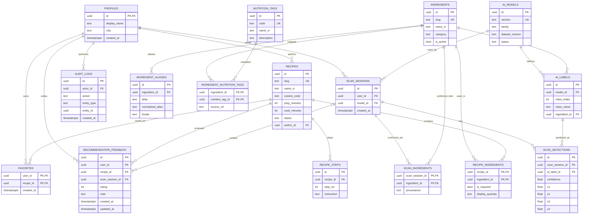

# Thiết kế Database và ERD

**Phiên bản:** 0.9.0-draft · **DB:** PostgreSQL >= 15 (Supabase) · **Trạng thái:** Đề xuất, chờ duyệt baseline

## 1. Sơ đồ ERD

Sơ đồ mô tả 16 bảng nghiệp vụ của MVP + P1, mối quan hệ PK/FK và bảng nối N–N. Xem bản nguồn tại [erd.mmd](erd.mmd).

## 2. Nguyên tắc mô hình hóa

1. `ingredients.id` là khóa UUID ổn định, **không dùng tên nguyên liệu hoặc chỉ số class YOLO làm khóa nghiệp vụ**. Hệ thống không có endpoint xóa cứng (`DELETE`) đối với `ingredients` và `recipes`; chỉ hỗ trợ xóa mềm/lưu trữ (`ingredients.is_active = false`, `recipes.status = 'archived'`).
2. `ai_labels` thuộc một `ai_models` cụ thể: `(model_id, class_index)` là duy nhất. Khi thay model, class_index có thể đổi; luôn ánh xạ lại model-label → ingredient (chỉ cho phép trỏ tới nguyên liệu hoạt động không thuộc nhóm gia vị nền `pantry`).
3. `recipe_ingredients` là bảng nối N–N giữa món và nguyên liệu, có `is_required` để phân biệt thành phần bắt buộc hay tùy chọn. Nguyên liệu thuộc `category = 'pantry'` (muối, đường, nước mắm, dầu ăn...) được dùng để hiển thị và kiểm tra loại trừ qua `excluded_pantry_ids`, không làm phồng điểm độ phủ khi sẵn có (xem [ADR-008](../07-decisions/ADR-008-pantry-ingredients-handling.md)).
4. `recipe_steps` chứa các bước nấu có thứ tự `(recipe_id, step_no)` duy nhất.
5. `total_minutes` tính bằng `prep_minutes + cook_minutes` trong API/DB query (trong đó `cook_minutes` bao gồm cả thời gian ướp/ủ/chờ bắt buộc theo [ADR-009](../07-decisions/ADR-009-cooking-and-waiting-time.md)), **không lưu cột tổng lặp lại**.
6. `nutrition_tags` là **mô tả định tính** được gắn với nguyên liệu qua `ingredient_nutrition_tags`, không có trường kcal/g nếu thiếu khối lượng xác thực.
7. `scan_sessions`, `scan_detections`, `scan_ingredients` **chỉ sinh bản ghi khi User đã đăng nhập và bật lưu lịch sử**; không lưu ảnh gốc ở MVP.
8. `favorites` và `recommendation_feedback` luôn thuộc user hiện tại; `audit_logs` chỉ server được tạo, client không tự ghi.

## 3. Ràng buộc then chốt

| Bảng | Ràng buộc cần áp dụng trong migration |
|---|---|
| `ingredients` | UNIQUE(slug), CHECK(slug không rỗng), `CHECK(category IN ('vegetable', 'protein', 'seafood', 'spice', 'pantry', 'other'))`, `is_active DEFAULT true` |
| `ingredient_aliases` | UNIQUE(ingredient_id, normalized_alias, locale), FK ON DELETE CASCADE |
| `ai_models` | UNIQUE(version); status trong `draft`, `active`, `archived`; chỉ **một** model `active` (unique partial index); mapping của model active/archived không được sửa tại chỗ |
| `ai_labels` | UNIQUE(model_id, class_index); FK model (`ON DELETE CASCADE`) và ingredient (`ON DELETE RESTRICT`); backend enforce `ingredient.category != 'pantry'` và `ingredient.is_active = true` |
| `recipes` | UNIQUE(slug); prep/cook ≥0, bắt buộc có ít nhất 1 bước + 1 required ingredient thuộc nhóm chính (`category != 'pantry'`), mọi nguyên liệu trong món đều `is_active = true`, và không có bước đơn lẻ nào có `estimated_minutes > prep_minutes + cook_minutes` mới được giữ/chuyển sang `published` |
| `recipe_ingredients` | PK(recipe_id, ingredient_id); FK recipe (`ON DELETE CASCADE`), FK ingredient (`ON DELETE RESTRICT`); `is_required` không null |
| `recipe_steps` | UNIQUE(recipe_id, step_no), step_no ≥1, `estimated_minutes >= 0` (nullable) |
| `ingredient_nutrition_tags` | PK(ingredient_id, nutrition_tag_id); source_url bắt buộc khi công bố |
| `scan_detections` | 0≤confidence≤1; 0≤x1<x2≤1 và 0≤y1<y2≤1 |
| `scan_ingredients` | PK(scan_session_id, ingredient_id), provenance `ai/manual/corrected` |
| `favorites` | PK(user_id, recipe_id) ngăn trùng |
| `recommendation_feedback` | `CHECK(rating BETWEEN 1 AND 5)`; `UNIQUE NULLS NOT DISTINCT (user_id, recipe_id, scan_session_id)` (yêu cầu PostgreSQL >= 15); FK `scan_session_id REFERENCES scan_sessions(id) ON DELETE CASCADE` (xem [ADR-012](../07-decisions/ADR-012-feedback-uniqueness-and-context.md)) |
| `profiles` | `id REFERENCES auth.users(id)`; role `user/admin` nhưng user thường không được tự sửa role |

**Quy tắc công bố recipe và bảo vệ nguyên liệu đang dùng cần enforce trong API transaction**:
- CHECK SQL đơn bảng không đủ để đếm dòng con ở `recipe_ingredients` / `recipe_steps`. API phải kiểm tra điều kiện `published` cả khi gọi `PATCH /admin/recipes/{id}/status` lẫn khi sửa trực tiếp một món đang `published` qua `PATCH /admin/recipes/{id}` (`400 RECIPE_NOT_PUBLISHABLE`).
- Khi gọi `PATCH /admin/ingredients/{id}` để đổi `category` (sang/từ `'pantry'`) hoặc đặt `is_active = false`, backend phải kiểm tra nguyên liệu đó không nằm trong bất kỳ công thức `published` nào và không nằm trong `ai_labels` của model `draft`/`active` (`400 INGREDIENT_IN_USE`). Bỏ qua model `archived` khi kiểm tra `INGREDIENT_IN_USE`, nhưng nếu Admin rollback model `archived` về `active` thì phải kiểm tra lại toàn bộ nhãn của model đó vẫn trỏ tới nguyên liệu `is_active = true` và `category != 'pantry'` (`400 MODEL_NOT_ACTIVATABLE`).

## 4. Index gợi ý

- `recipes(status, cuisine_code)`; `recipes(status, prep_minutes, cook_minutes)` hoặc expression index `status,(prep_minutes+cook_minutes)` tùy thống kê truy vấn.
- `recipe_ingredients(ingredient_id, recipe_id)` ngoài composite PK.
- `recipe_steps(recipe_id, step_no)` UNIQUE.
- `ai_labels(model_id, class_index)` UNIQUE.
- `ingredient_aliases(locale, normalized_alias)` hỗ trợ tìm kiếm.
- `scan_sessions(user_id, created_at DESC)`; `audit_logs(created_at DESC, actor_id)`.
- `favorites(user_id, created_at DESC)` nếu cần sắp xếp gần nhất.

Chỉ thêm index theo kết quả `EXPLAIN ANALYZE` và dữ liệu thực, không coi tất cả đều bắt buộc ngay.

## 5. Luồng cập nhật dữ liệu

- **Admin tạo/sửa món:** tạo recipe `draft` → thêm `recipe_ingredients`, `recipe_steps` → validate (đủ bước, đủ nguyên liệu bắt buộc ngoài `pantry`, mọi nguyên liệu `is_active = true`, không có bước đơn lẻ `estimated_minutes > prep_minutes + cook_minutes`) → chuyển `published` → ghi audit. Nếu sửa trực tiếp món đang `published`, các điều kiện trên vẫn được kiểm tra trong transaction.
- **Admin cập nhật nhãn AI:** chọn model `draft` → ánh xạ `class_index` sang mã nguyên liệu chuẩn (`category != 'pantry'`, `is_active = true`); không thay ID nguyên liệu có sẵn để tránh lỗi lịch sử. Hỗ trợ rollback model từ `archived` về `active` sau khi xác minh toàn bộ nhãn của model đó còn hợp lệ.
- **User nhận diện:** giải mã ảnh, xoay chuẩn chiều theo EXIF, loại bỏ toàn bộ metadata EXIF/GPS và không persist ảnh gốc; file tạm phải dọn sạch. Nếu bật `save_history=true`, insert `scan_session` + raw detections; sau khi request recommendations xác nhận danh sách nguyên liệu chính, cập nhật `scan_ingredients` nếu scan thuộc chính user đó.
- **Xóa lịch sử scan & Xóa tài khoản:** khi User xóa một hoặc nhiều `scan_sessions` (hoặc xóa tài khoản), các bản ghi con trong `scan_detections`, `scan_ingredients` và các đánh giá gắn phiên trong `recommendation_feedback` được xóa tự động qua `ON DELETE CASCADE` (không gây va chạm `UNIQUE NULLS NOT DISTINCT` với bản ghi `scan_session_id IS NULL`); dữ liệu cá nhân `favorites` và `recommendation_feedback` của user cũng được xóa theo chính sách quyền riêng tư (`NFR-06`).

## 6. Quyền dữ liệu

| Nhóm | Guest | User | Admin (`Admin --\|> User`) |
|---|---|---|---|
| Published recipes/ingredients/tags | Read | Read | Read/Write qua Backend |
| Draft/archived recipes | Không | Không | Read/Write qua Backend |
| Favorites | Không | Chỉ chính mình | Chỉ chính mình (khuyến nghị tách tài khoản vận hành) |
| Scan history | Không | Chỉ chính mình (có consent) | Chỉ chính mình (khuyến nghị tách tài khoản vận hành) |
| Admin audit | Không | Không | Read có kiểm soát |

Phải kết hợp **GRANT/REVOKE và RLS** khi dùng Data API; backend dùng service-role (nếu có) phải tự enforce quyền. Chi tiết ở [security-and-deployment.md](security-and-deployment.md).
