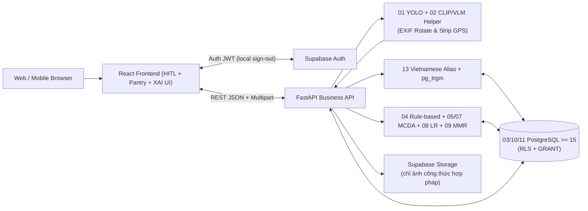
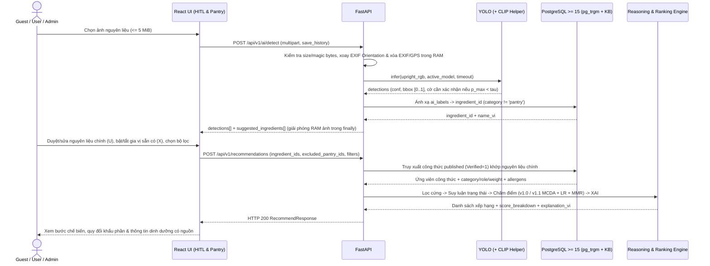

# Thiết kế kiến trúc hệ thống — System Architecture

**Mã tài liệu:** `FV-ARCH-001` · **Phiên bản:** `1.0.0` · **Trạng thái:** Chính thức (`Approved Baseline`) · **Phạm vi:** Kiến trúc 7 tầng tích hợp 14 thành phần thông minh và các quyết định [`ADR-001`](../07-decisions/ADR-001-web-fastapi.md)…[`ADR-012`](../07-decisions/ADR-012-feedback-uniqueness-and-context.md).

## 1. Kiến trúc 7 tầng thông minh và nguyên tắc phân tách trách nhiệm

FoodVision AI là **website responsive** (không xây dựng ứng dụng Android/iOS native ở MVP), được thiết kế theo nguyên tắc **tách biệt rõ nhận thức thị giác, cơ sở tri thức, suy luận quy tắc, xếp hạng đa tiêu chí và học máy cá nhân hóa** — tránh đánh đồng việc gọi mô hình YOLO với việc toàn bộ hệ gợi ý tự học hộp đen.

### 1.1. Ánh xạ 7 tầng thông minh và 14 thành phần kỹ thuật

| Tầng thông minh | Thành phần đảm nhiệm | Đầu ra chính |
|---|---|---|
| **1. Nhận thức (Perception)** | `01` YOLO Object Detection · `02` CLIP/VLM Candidate Helper · `14` HITL + Tiền xử lý EXIF ([`ADR-010`](../07-decisions/ADR-010-image-exif-and-validation-errors.md)) | Danh sách nguyên liệu chính (`U`) và gia vị nền báo thiếu (`X`) đã được người dùng xác nhận |
| **2. Tri thức & Tìm kiếm** | `13` Chuẩn hóa tiếng Việt (`unaccent` + `pg_trgm`) · `03` PostgreSQL KB · `10` Verified Retrieval | Mã `ingredient_id` UUID chuẩn và tập ứng viên công thức `published` chống ảo giác |
| **3. Suy luận (Reasoning)** | `04` Rule-based Reasoning (3 trạng thái + `pantry` + ràng buộc cứng) | Phân loại `BLOCKED` / `READY` / `UNKNOWN` / `MISSING_CONFIRMED` và danh sách nguyên liệu thiếu/chưa biết |
| **4. Ra quyết định (Decision)** | `05` Weighted Coverage · `07` MCDA Scoring (`Scoring v1.0` → `v1.1`) · `09` MMR | Điểm tương thích `0..100` và danh sách Top-K đa dạng phương pháp chế biến/ẩm thực |
| **5. Học hỏi (Learning)** | `08` Logistic Regression theo phản hồi tường minh ([`ADR-012`](../07-decisions/ADR-012-feedback-uniqueness-and-context.md)) | Xác suất sở thích $p_{u,r}$ kết hợp cơ chế trộn điểm an toàn `cold-start` (Giai đoạn 4 — `P1`) |
| **6. Kiểm chứng & Giải thích** | `06` Tversky Baseline B · `12` Metrics (`mAP`, `nDCG@5`, `P@5`) · `14` Score Breakdown XAI | Bằng chứng đối chứng thực nghiệm `A – B – C – D` và bảng phân rã tuyến tính điểm thành phần |
| **7. Thông tin bổ sung** | `10` Quy đổi khẩu phần · `11` Dinh dưỡng 2 tầng (Tags `P0` + USDA `P1`) | Nhóm chất định tính có dẫn nguồn và ước tính `kcal`/dinh dưỡng khi có định lượng `grams` kiểm duyệt |

### 1.2. Các lớp công nghệ triển khai

| Lớp | Công nghệ đề xuất | Trách nhiệm chính |
|---|---|---|
| `Web Client` | React + TypeScript + Vite + Tailwind CSS | Tải ảnh, hiển thị `bbox` trên ảnh chuẩn chiều EXIF, cảnh báo HITL ($p_{\max} < \tau$), tìm kiếm tiếng Việt, thanh bật/tắt gia vị nền (`pantry`), hiển thị Top-K + XAI |
| `Business API` | Python + FastAPI | Kiểm tra đầu vào/magic bytes, xác minh Supabase JWT, kế thừa quyền `Admin --\|> User`, chuẩn hóa 20 mã lỗi, điều phối AI / Search / Recommendation / Nutrition |
| `Perception Adapter` | Ultralytics YOLO + CLIP/VLM helper tùy chọn | Xoay EXIF Orientation & xóa EXIF/GPS trong RAM → suy luận có giới hạn đồng thời & timeout (`504`) → ánh xạ `ai_labels` (`category != 'pantry'`) |
| `Search & Normalization` | Python Unicode NFD normalizer + PostgreSQL `unaccent` / `pg_trgm` | Chuẩn hóa có dấu/không dấu, tra cứu `ingredient_aliases` (`"đậu hũ"` ↔ `"đậu phụ"`) và tìm gần đúng trên GIN index |
| `Recommendation Engine` | Python module độc lập (`reasoning`, `coverage`, `scoring`, `personalization`, `mmr`) | Hỗ trợ `Scoring v1.0` (MVP contract) và `Scoring v1.1` (3 trạng thái, Weighted Coverage, MCDA 5 tiêu chí, Logistic Regression, MMR, XAI) |
| `Persistence` | Supabase PostgreSQL (`>= 15`) | Lưu trữ nguyên liệu (`pantry` tách biệt), alias, công thức kiểm duyệt, trọng số $w_{r,i}$, dị ứng, dinh dưỡng, lịch sử opt-in, feedback (`UNIQUE NULLS NOT DISTINCT`), audit logs |
| `Auth & Storage` | Supabase Auth + Supabase Storage | Đăng nhập/khôi phục mật khẩu/đăng xuất cục bộ (`scope: 'local'`); Storage chỉ lưu ảnh minh họa công thức hợp pháp (**tuyệt đối không lưu ảnh gốc của người dùng**) |

## 2. Sơ đồ kiến trúc tổng quan



Sơ đồ nguồn chỉnh sửa: [architecture.mmd](architecture.mmd).

## 3. Biểu đồ tuần tự — Luồng nhận diện, xác nhận HITL và gợi ý món



## 4. Phân tách cấu trúc module gợi ý khi lập trình

```text
frontend/src/
  features/scan/         # tải ảnh, vẽ bbox trên ảnh chuẩn EXIF, cảnh báo p_max < tau, sửa nhãn HITL
  features/search/       # tìm kiếm nguyên liệu tiếng Việt có dấu/không dấu/alias + thanh gia vị pantry
  features/recommend/    # bộ lọc thời gian/ẩm thực/dị ứng, thẻ trạng thái món, bảng giải thích điểm XAI
  features/recipes/      # chi tiết công thức kiểm duyệt, tách khu vực gia vị nền, đổi khẩu phần, dinh dưỡng
  features/auth/         # Supabase Auth SDK (signIn, resetPasswordForEmail, signOut local), favorites, history
  features/admin/        # quản trị công thức, nguyên liệu/alias, model AI/rollback, nhãn dinh dưỡng, audit logs
  shared/api/            # typed REST client đồng bộ với openapi.yaml

backend/app/
  api/v1/                # REST routers khớp 33 operations trong openapi.yaml
  core/                  # config, Supabase JWT verifier, Admin --|> User dependency, 20 error handlers
  models/                # Pydantic schemas
  services/image/        # magic-byte check, EXIF Orientation transpose, EXIF/GPS metadata stripper
  services/detection/    # YOLO runner (01), optional CLIP candidate helper (02), HITL review threshold (14)
  services/normalization/# Unicode NFD + đ->d + tra cứu ingredient_aliases & pg_trgm (13)
  services/recommend/
    v1_rule_scorer.py    # Scoring v1.0 khớp hợp đồng MVP hiện hành (E, C, T, P, excluded_pantry_ids)
    reasoning.py         # Open-world 3-state reasoning & lọc cứng dị ứng/thiết bị/thời gian (04)
    coverage.py          # Weighted Coverage (05) & Tversky Similarity Baseline B (06)
    scoring.py           # MCDA 5 tiêu chí (07) & Score Breakdown XAI (14)
    personalization.py   # Logistic Regression user preference & cold-start blend (08)
    mmr.py               # Maximal Marginal Relevance đa dạng hóa Top-K (09)
  services/nutrition/    # nhãn định tính (P0) & USDA per-100g calculator theo khẩu phần (10, 11)
  repositories/          # truy vấn PostgreSQL >= 15
  evaluation/            # script đo mAP@50:95 và đối chứng Precision@5, nDCG@5 cho A/B/C/D (12)
```

*(Cấu trúc thư mục trên là định hướng tổ chức mã nguồn, không hàm ý mã nguồn đã được cài đặt sẵn).*

## 5. Lộ trình triển khai 5 giai đoạn

| Giai đoạn | Thành phần triển khai | Sản phẩm kiểm thử bàn giao |
|---|---|---|
| **1 — Dữ liệu & Logic nền (`P0`)** | `03` PostgreSQL `>= 15` KB, `04` Rule-based + `pantry`, `10` Verified Retrieval, `13` Tiếng Việt (`pg_trgm`) | Schema migration + seed 5 gia vị nền, tìm kiếm không dấu/alias, truy xuất món `published` và kiểm tra ràng buộc xuất bản |
| **2 — Bộ đề xuất cốt lõi (`P0`)** | `05` Weighted Coverage, `06` Tversky baseline, `07` MCDA (`Scoring v1.0` & `v1.1`), `09` MMR | API `/recommendations` chấm điểm chính xác, xử lý `excluded_pantry_ids`, đa dạng hóa MMR và sẵn sàng baseline Tversky |
| **3 — Thị giác, HITL & CMS (`P0`)** | `01` YOLO, `02` CLIP helper, `14` HITL & XAI + EXIF privacy + Admin CMS (`FR-09a`, `FR-13..15`) | Luồng khép kín: Ảnh → xoay EXIF & xóa GPS → YOLO → sửa nhãn & bật/tắt gia vị → gợi ý có giải thích điểm + quản trị model/rollback |
| **4 — Cá nhân hóa & Dinh dưỡng (`P1`)** | `08` Logistic Regression, `11` Dinh dưỡng USDA + User Auth (`FR-09b..12`, `FR-16..17`) | Đăng ký/đăng nhập User, yêu thích, lịch sử opt-in, feedback upsert (`UNIQUE NULLS NOT DISTINCT`), học sở thích LR & tính `kcal` theo gram chuẩn |
| **5 — Kiểm chứng thực nghiệm (`P0`/`P1`)** | `12` Đánh giá hai tầng & đối chứng `A – B – C – D` | Báo cáo `mAP@50:95` tuân thủ `NFR-11`, bảng đối chứng `Precision@5` / `nDCG@5` (A/B/C/D), nghiệm thu chéo 47 TC & 10 kịch bản bảo vệ |

## 6. Các luồng phòng vệ an toàn bắt buộc

- Ảnh hỏng / sai MIME / vượt `5 MiB`: trả `422 INVALID_IMAGE` / `415 UNSUPPORTED_IMAGE_TYPE` / `413 IMAGE_TOO_LARGE`, giải phóng bộ nhớ tạm ngay lập tức.
- Dịch vụ AI chưa sẵn sàng (`503 MODEL_NOT_READY`) hoặc quá hạn suy luận (`504 INFERENCE_TIMEOUT`): giao diện tự động mở luồng tìm kiếm/chọn nguyên liệu tiếng Việt thủ công (`FR-18`) để hệ gợi ý vẫn hoạt động độc lập.
- Hộp phát hiện có độ tin cậy $< \tau$ hoặc khớp từ khóa gần đúng `pg_trgm`: gắn cảnh báo xác nhận HITL trên giao diện, không tự chốt ngầm.
- Công thức vi phạm bất kỳ điều kiện nào trong 4 điều kiện xuất bản (`BR-01`, `BR-05`) hoặc nguyên liệu đang dùng bị tắt/đổi nhóm `pantry`: chặn cứng ở tầng giao dịch API bằng `400 RECIPE_NOT_PUBLISHABLE` / `400 INGREDIENT_IN_USE`.
