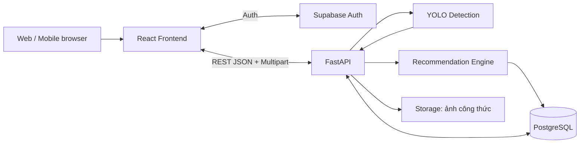
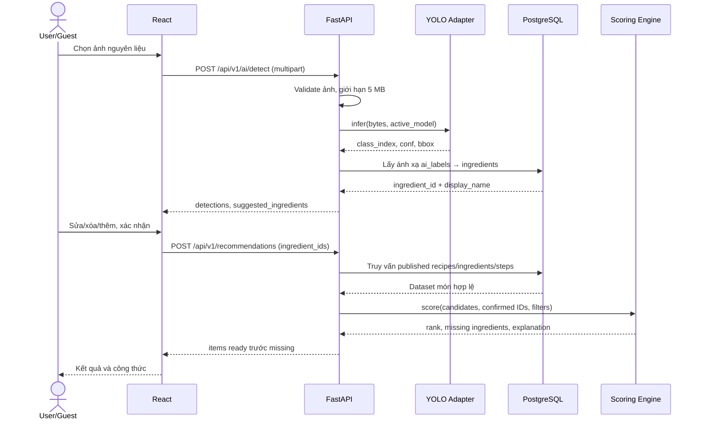

# Thiết kế kiến trúc hệ thống — System Architecture

**Tài liệu:** FV-ARCH-001 · **Trạng thái:** Đề xuất

## 1. Các quyết định thiết kế

FoodVision AI là **website responsive**, không làm ứng dụng Android/iOS native ở MVP. Kiến trúc theo nguyên tắc *tách trách nhiệm*, tránh để nhận diện AI đảm nhiệm công thức hoặc dữ liệu.

| Lớp | Công nghệ đề xuất | Trách nhiệm |
|---|---|---|
| UI | React + TypeScript + Vite + Tailwind | Upload ảnh, sửa nguyên liệu, tìm kiếm/lọc, hiển thị món, đăng nhập |
| REST API | Python FastAPI | Validate input, xác minh JWT, nghiệp vụ admin, gọi model và scoring, chuẩn hóa response |
| AI Adapter | Ultralytics YOLO (version chốt sau thử nghiệm) | Một ảnh → list class_index/confidence/bbox chuẩn hóa; ánh xạ label theo phiên bản |
| Recommendation | Python module độc lập | Lọc món published, tính điểm C/E/T/P, gom nhóm ready/missing và giải thích |
| Persistence | Supabase PostgreSQL | Nguyên liệu, alias, công thức, steps, nhãn AI, tags, favorites, audit, scan history có consent |
| Auth | Supabase Auth | Đăng nhập, đăng ký, cấp token; quyền Admin kiểm tra phía server |
| Object Storage | Supabase Storage | Chỉ ảnh cover/công thức có quyền; **không lưu ảnh nguyên liệu upload trong MVP** |

## 2. Sơ đồ tổng quan



Sơ đồ chi tiết được lưu dưới dạng nguồn chỉnh sửa: [architecture.mmd](architecture.mmd).

## 3. Sequence — luồng nhận diện và gợi ý



Lưu ý: việc xác nhận sửa nguyên liệu diễn ra tại FE, API gợi ý nhận danh sách **ID đã xác nhận**. `scan_id` chỉ được ghi DB nếu user bật `save_history=true` và xác thực thành công.

## 4. Phân tách module gợi ý cho nhóm lập trình

```text
frontend/src/
  features/scan/         # chọn ảnh, bbox, correction
  features/recipes/      # list, detail, filters
  features/recommend/    # request và hiển thị rank
  features/auth/         # Supabase Auth SDK
  features/admin/        # CRUD dành cho Admin
  shared/api/            # generated client hoặc fetch typed

backend/app/
  api/v1/                # REST endpoints
  core/                  # config, security, errors
  models/                # pydantic DTO
  services/detection/    # YOLO wrapper + class mapping
  services/recommend/    # score function thuần
  repositories/          # truy vấn DB
  tests/                 # contract, unit, integration
```

Đây là cấu trúc **đề xuất**, không khẳng định các thư mục đã tồn tại trong repo. Thành viên FE có thể bám `docs/03-api/openapi.yaml` để mock API trước khi BE hoàn thành. Không để Frontend phụ thuộc trực tiếp vào model AI hoặc service-role secret.

## 5. Các luồng lỗi cần thiết

- Ảnh hỏng/giả MIME: trả 422 hoặc 415, giữ nguyên ảnh trong UI để chọn lại.
- Hệ AI chưa sẵn sàng: trả 503, hiển thị nhập nguyên liệu thủ công và vẫn cho recommend.
- API vượt thời gian: FE thông báo thử lại, không gọi vô hạn.
- Dữ liệu món thiếu nguyên liệu/bước: từ chối chuyển sang `published`.
- Quyền Admin không hợp lệ: trả 401 (chưa xác thực) hoặc 403 (đã xác thực nhưng không quyền), log từ chối phù hợp.

## 6. Mở rộng tương lai

Có thể thêm nhãn AI và bộ công thức mà không đổi logic score nếu mỗi nhãn ánh xạ về `ingredient_id` chuẩn. Khi cần, scale AI inference bằng worker GPU độc lập, cache truy vấn công thức và dùng CDN cho ảnh công thức. Tại MVP chưa cần queue phức tạp hoặc microservices riêng cho từng thành phần.
