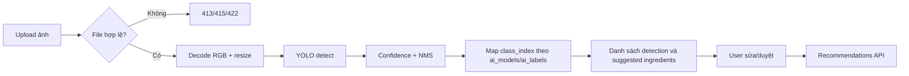

# Thiết kế phân hệ AI — Ingredient Object Detection

**Mã:** FV-AI-001 · **Trạng thái:** Proposed · **Nhiệm vụ:** object detection nhiều nguyên liệu trong 1 ảnh.

## 1. Vì sao dùng YOLO?

YOLO Object Detection cung cấp `class`/`confidence`/`bounding box` cho từng vật thể trong ảnh. Bài toán cần **nhiều nguyên liệu xuất hiện đồng thời** nên mô hình classification đơn nhãn không phù hợp. YOLO **chỉ nhận diện**, không được đặt món ăn hoặc tạo hướng dẫn chế biến. Recommendation Engine riêng sẽ xử lý món ăn từ dữ liệu structured.

**Mô hình cụ thể:** chọn biến thể YOLO sau khi so sánh bản nhỏ (ưu tiên inference CPU) và bản có chất lượng cao hơn nếu có GPU; không gắn cứng version chỉ vì xuất hiện trong tài liệu mẫu. Giấy phép Ultralytics cần được kiểm tra trước phát hành; xem [ADR-005](../07-decisions/ADR-005-yolo-licensing.md).

## 2. Dữ liệu vào/ra

- Input: một ảnh JPEG/PNG/WebP, kích thước file ≤5 MiB, xử lý tạm thời theo request, không lưu ảnh gốc bền vững; framework có thể dùng spool tạm và phải dọn sạch; backend giải mã hình ảnh RGB và resize/letterbox theo model.
- Output raw từ model: `(class_index, confidence, bbox_xyxy)` trên nhiều object.
- Hậu xử lý: NMS và lọc theo confidence threshold **cấu hình theo model version**, quy đổi bbox về tọa độ ảnh gốc rồi chuẩn hóa [0,1]; tra `ai_labels(model_id, class_index)` để lấy ingredient_id.
- Output API: `detections[]` đầy đủ với từng box; `suggested_ingredients[]` khử trùng lặp theo mã nguyên liệu, lấy `max_confidence` để UI hiển thị.
- **Không ước lượng gram** từ số box, kích thước box hay vật thể đơn lẻ; không thể suy ra khẩu phần chính xác từ ảnh bất kỳ.

## 3. Pipeline inference



### Quy tắc confidence

- Khởi điểm thử nghiệm `confidence_threshold=0.25`, không coi đây là ngưỡng tối ưu. Dùng validation set để tìm ngưỡng phù hợp giữa precision/recall.
- Bbox/detection có `ingredient_id=null` nếu phát hiện không ánh xạ được trong tình huống lỗi dữ liệu; ghi log và không tự đề xuất món từ nhãn thiếu ánh xạ.
- Trường hợp detection=[] sau inference thành công vẫn `HTTP 200`, hướng dẫn nhập tay.
- Chưa hỗ trợ tự động phân biệt tất cả nguyên liệu đã chế biến, bột, nước sốt, chất lỏng hoặc thịt đã cắt vụn; chỉ công bố lớp đã có bằng chứng chất lượng.

## 4. Mở rộng nhãn và versioning

Một class YOLO không phải primary key. Mỗi lần train dataset thay đổi lớp/thứ tự lớp phải tạo `ai_models.version` mới, đăng ký toàn bộ `(model_id, class_index, class_name, ingredient_id)` ở `ai_labels`. Có thể sử dụng lại `ingredient_id` khi tên nhãn class mới tương đương, nhưng không thay ID đã dùng trong công thức.

Ví dụ:

```text
Model food-yolo-v1: class=0, tomato -> ingredients.id(tomato)
Model food-yolo-v2: class=12, tomato -> cùng ingredients.id(tomato)
```

Quy trình: thêm ảnh + nhãn → gán nhãn và duyệt → train/eval → tạo model version draft → kiểm tra tất cả class mapping → benchmark → kích hoạt một model active (không cho sửa mappings của model active) → giữ version cũ để rollback. Không huấn luyện trực tiếp từ ảnh khách mà chưa có đồng ý, phân loại nhãn đúng và quyền sử dụng.

## 5. Giao diện và khả năng tự sửa

Frontend cần hiển thị: các hộp phát hiện (nếu có), tên + confidence, danh sách loại nguyên liệu gộp trùng, nút xóa/sửa/nhập tay. Xử lý thành công nghĩa là User **xác nhận danh sách cuối**, không phải AI đạt 100% accuracy. Bảng `scan_ingredients` chỉ lưu nếu đã bật history và user gửi danh sách đã xác nhận qua API gợi ý.

## 6. Lỗi và vận hành

| Tình huống | Hành vi |
|---|---|
| File ảnh giả / không decode | 415/422, không chạy model |
| Không có đối tượng | 200 + danh sách rỗng, hiển thị nhập tay |
| Thời gian inference quá cao | Giới hạn timeout/concurrency, thông báo thử lại |
| Model không load / không active | 503 `MODEL_NOT_READY` |
| Nhãn AI không tìm thấy mapping | Không gán ingredient_id bừa; log lỗi mapping |
| Hai bbox cùng loại | Giữ 2 bbox nếu hợp lệ, nhưng gộp `suggested_ingredients` theo mã chuẩn |

## 7. Checklist trước tích hợp

- [ ] Hoàn thành bảng nhãn được nhóm duyệt và nguồn dataset.
- [ ] Có file `dataset.yaml` và manifest split train/val/test.
- [ ] Có trọng số model có quyền sử dụng, version, hash và log training.
- [ ] Có số liệu precision/recall/mAP theo từng lớp trên test độc lập.
- [ ] Đo latency p50/p95 và tài nguyên trên máy demo.
- [ ] Giao diện correction, empty prediction và manual fallback hoạt động.

Tham khảo chính: https://docs.ultralytics.com/tasks/detect và https://docs.ultralytics.com/datasets/detect.
