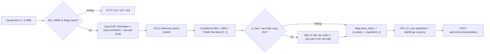

# Thiết kế phân hệ AI — Ingredient Object Detection, CLIP/VLM Fallback & HITL

**Mã:** `FV-AI-001` · **Phiên bản:** `0.9.1-draft` · **Trạng thái:** Proposed · **Phạm vi kỹ thuật:** Thành phần 01 (YOLO Object Detection), Thành phần 02 (CLIP/VLM Candidate Helper), Thành phần 14 (Human-in-the-loop) & [`ADR-010`](../07-decisions/ADR-010-image-exif-and-validation-errors.md).

## 1. Cơ sở khoa học và vai trò của YOLO (Thành phần 01)

Bài toán nhận thức đầu vào là phát hiện **nhiều loại nguyên liệu thực phẩm/gia vị tươi có hình khối cùng xuất hiện trong một ảnh chụp thực tế** (trên bàn bếp, trong rổ hoặc ngăn tủ lạnh), kèm vị trí hộp giới hạn (`bbox`) và độ tin cậy (`confidence`) để người dùng kiểm tra trực quan. Họ mô hình **YOLO (You Only Look Once)** khởi nguồn từ Redmon et al. (*CVPR*, 2016) giải bài toán phát hiện đối tượng một giai đoạn (one-stage detector), cân bằng tốt giữa tốc độ suy luận và độ chính xác định vị.

### 1.1. Công thức IoU (Intersection over Union)

Với hộp dự đoán $B_p$ và hộp gán nhãn chuẩn (ground truth) $B_g$, mức độ trùng khớp không gian dùng trong huấn luyện, hậu xử lý Non-Maximum Suppression (NMS) và đánh giá `mAP` được đo bằng:

\[
\text{IoU}(B_p, B_g) = \frac{|B_p \cap B_g|}{|B_p \cup B_g|} \in [0, 1]
\]

**Ví dụ minh họa tính tay:** nếu diện tích phần giao $|B_p \cap B_g| = 40$ và diện tích phần hợp $|B_p \cup B_g| = 70$ thì $\text{IoU} = 40 / 70 \approx 0.5714$ (vượt ngưỡng chuẩn `0.50` của chỉ số `AP@50`).

### 1.2. Ranh giới nhiệm vụ và lựa chọn biến thể

- **Lựa chọn kiến trúc:** ưu tiên biến thể Ultralytics YOLO kích thước nhẹ (`nano` / `small`) để đáp ứng mục tiêu độ trễ `p95 <= 10.0s` trên CPU demo (`<= 3.0s` trên GPU) theo `NFR-02`; tên biến thể cụ thể chỉ khóa sau khi chạy benchmark thực tế và kiểm tra giấy phép ([`ADR-005`](../07-decisions/ADR-005-yolo-licensing.md)).
- **Ranh giới trách nhiệm:** YOLO chỉ nhận diện các nguyên liệu có hình khối nằm trong tập nhãn đã huấn luyện (`category != 'pantry'`). Mô hình **không tự chọn món ăn**, **không nhận diện gia vị nền đựng trong chai lọ kín (`category = 'pantry'`)**, và **tuyệt đối không suy diễn khối lượng (`gram`) hay năng lượng (`kcal`) từ diện tích hộp giới hạn**.

## 2. Lớp hỗ trợ ứng viên vùng ảnh khó bằng CLIP / VLM (Thành phần 02 — Tùy chọn có kiểm soát)

Trong thực tế nhà bếp, một số vùng ảnh nguyên liệu bị cắt nhỏ, bọc túi bóng hoặc dễ gây nhầm lẫn hình thái (ví dụ khối **đậu hũ trắng** dễ nhầm phô mai trắng/thạch; **dưa leo** dễ nhầm bí ngòi). Khi hộp phát hiện của YOLO có độ tin cậy thấp ($p_{\max} < \tau$) hoặc người dùng yêu cầu gợi ý thêm trên vùng cắt ảnh (`crop`), hệ thống có thể kích hoạt lớp đối sánh biểu diễn đa phương thức **CLIP** (Radford et al., *ICML*, 2021):

\[
\text{Sim}(I, T_m) = \frac{f(I) \cdot g(T_m)}{\|f(I)\|\,\|g(T_m)\|}
\]

Trong đó $f(I)$ là vector biểu diễn vùng ảnh nguyên liệu và $g(T_m)$ là vector biểu diễn mô tả văn bản chuẩn của nguyên liệu ứng viên $m$ trong danh mục nội bộ (`category != 'pantry'`).

- **Ví dụ tính tay:** với $f(I) = [0.8, 0.6]$ và $g(T) = [0.9, 0.4]$, ta có $\|f(I)\| = 1.0$, $\|g(T)\| = \sqrt{0.97} \approx 0.9849$ và $\text{Sim}(I, T) = \frac{0.8(0.9) + 0.6(0.4)}{1.0 \times \sqrt{0.97}} = \frac{0.96}{\sqrt{0.97}} \approx 0.975$.
- **Quy tắc an toàn:** lớp CLIP/VLM chỉ dùng để **xếp hạng danh sách ứng viên gợi ý có kiểm soát cho người dùng xác nhận trên giao diện**, không tự ý chốt nguyên liệu ngầm và không dùng sinh công thức tự do. Ở cấu hình MVP tối giản (`P0`), hệ thống vẫn vận hành đầy đủ chỉ với YOLO + tìm kiếm tiếng Việt thủ công (`FR-18`).

## 3. Pipeline tiền xử lý EXIF, suy luận và hậu xử lý



- **Tiền xử lý bắt buộc (`FR-03`, [`ADR-010`](../07-decisions/ADR-010-image-exif-and-validation-errors.md)):** kiểm tra dung lượng (`<= 5 MiB`, quá hạn trả `413 IMAGE_TOO_LARGE`), kiểm tra MIME/magic bytes (`image/jpeg`, `image/png`, `image/webp`; sai trả `415 UNSUPPORTED_IMAGE_TYPE`), giải mã ảnh an toàn (hỏng trả `422 INVALID_IMAGE`), **đọc cờ `EXIF Orientation` để xoay pixel về đúng chiều hiển thị chuẩn (upright), và xóa sạch toàn bộ metadata `EXIF/GPS` trong RAM** trước khi đưa vào YOLO. Không lưu ảnh gốc bền vững; bộ nhớ đệm được giải phóng trong khối `finally`.
- **Hậu xử lý (`FR-04`):** lọc theo `confidence_threshold` (khởi điểm thử nghiệm `0.25`, tinh chỉnh trên tập `val`), chạy NMS, quy đổi `bbox` (`x1, y1, x2, y2`) chuẩn hóa `[0, 1]` **trên khung ảnh đã xoay EXIF**, và ánh xạ `(model_id, class_index)` sang `ingredient_id` qua bảng `ai_labels`.
- **Khử trùng lặp gợi ý:** `detections[]` giữ nguyên từng hộp phát hiện hợp lệ; `suggested_ingredients[]` gộp trùng theo `ingredient_id` (chỉ gồm nguyên liệu chính `category != 'pantry'`) với `max_confidence`.

## 4. Cơ chế Human-in-the-loop (Thành phần 14)

### 4.1. Luật cảnh báo xác nhận theo độ tin cậy

Các mạng nơ-ron sâu hiện đại có thể quá tự tin hoặc bất định trên ảnh thực tế (Guo et al., *ICML*, 2017). Với ngưỡng xác nhận $\tau \in (0, 1)$ được chọn trên tập `validation` (ví dụ khởi điểm $\tau = 0.80$), quy tắc cảnh báo xác nhận trên giao diện được định nghĩa:

\[
\text{Review}(x) = \mathbb{1}[p_{\max}(x) < \tau]
\]

Khi $\text{Review}(x) = 1$, giao diện đánh dấu cảnh báo trực quan (*"Cần kiểm tra lại nhãn"*) để người dùng chú ý xác nhận hoặc đổi nhãn trước khi gợi ý món. Đồng thời, vì ảnh mờ, che khuất hoặc ngoài phân phối (OOD) vẫn có thể sinh dự đoán sai, **mọi kết quả nhận diện đều đi qua màn hình xác nhận của người dùng (`FR-05`)** trước khi gọi `/api/v1/recommendations`.

### 4.2. Làm rõ bản chất "cập nhật từ thao tác sửa nhãn"

Nếu AI dự đoán nhầm `"bí ngòi"` ($0.55$) nhưng người dùng sửa thành `"dưa leo"`, hệ thống **dùng ngay mã chuẩn của `"dưa leo"` cho phiên gợi ý hiện tại**. Bản ghi `provenance = 'corrected'` trong `scan_ingredients` (chỉ lưu khi người dùng đăng nhập và chủ động bật `save_history = true`) chỉ đóng vai trò dữ liệu tham khảo để đội ngũ AI rà soát về sau — **mô hình YOLO tuyệt đối không tự cập nhật trọng số tức thời sau một cú nhấp chuột của người dùng**.

## 5. Quản lý phiên bản nhãn, tính bất biến và Rollback (`FR-15`, `BR-02`, `BR-12`)

Chỉ số `class_index` của YOLO phụ thuộc từng lần xuất mô hình nên không bao giờ được dùng làm khóa nghiệp vụ thay cho `ingredients.id`:

```text
Model food-yolo-v1: class=0, tomato -> ingredients.id(tomato)
Model food-yolo-v2: class=12, tomato -> cùng ingredients.id(tomato)
```

- **Ràng buộc ánh xạ nhãn (`BR-12`):** `ai_labels` chỉ được trỏ tới nguyên liệu có `is_active = true` và `category != 'pantry'`. Gán hoặc sửa nhãn trỏ tới nguyên liệu `pantry` hoặc `inactive` bị từ chối với `400 INVALID_LABEL_MAPPING`.
- **Tính bất biến (`BR-02`):** chỉ cho phép thêm/sửa `ai_labels` khi model ở trạng thái `draft`. Model đang `active` hoặc `archived` là bất biến (`400 MODEL_IMMUTABLE`).
- **Kích hoạt và Rollback (`PATCH /api/v1/admin/ai-models/{model_id}/status`):** cho phép chuyển `draft -> active` hoặc **rollback `archived -> active`**. Trong cả hai chiều, backend kiểm tra trong cùng một giao dịch DB: (1) toàn bộ lớp của model đã được ánh xạ đầy đủ (`unmapped_class_indices = []`), và (2) mọi nguyên liệu được ánh xạ hiện vẫn `is_active = true` và `category != 'pantry'` (`invalid_mapped_class_indices = []`); nếu vi phạm trả `400 MODEL_NOT_ACTIVATABLE`. Khi hợp lệ, model `active` cũ tự động chuyển sang `archived` trong cùng giao dịch (tối đa 1 model `active`).

## 6. Xử lý lỗi vận hành

| Tình huống | Hành vi hệ thống |
|---|---|
| Tệp vượt quá `5 MiB` | Trả `413 IMAGE_TOO_LARGE`, không chạy model |
| Sai định dạng MIME (không phải JPEG/PNG/WebP, ví dụ TIFF/HEIC/PDF) | Trả `415 UNSUPPORTED_IMAGE_TYPE`, không chạy model |
| Tệp giả mạo đuôi ảnh hoặc byte ảnh bị hỏng | Trả `422 INVALID_IMAGE`, giải phóng bộ nhớ tạm |
| Không phát hiện được đối tượng nào sau suy luận hợp lệ | Trả `200 OK` với `detections: []`, chuyển mượt sang ô tìm kiếm/nhập tay tiếng Việt (`FR-18`) |
| Phát hiện có độ tin cậy thấp ($p_{\max} < \tau$) | Trả `200 OK`, giao diện bật cảnh báo xác nhận HITL ($\text{Review}(x)=1$) |
| Thời gian suy luận vượt ngưỡng timeout cấu hình | Hủy tác vụ, giải phóng tài nguyên và trả `504 INFERENCE_TIMEOUT`; cho phép thử lại hoặc nhập tay |
| Chưa có model nào ở trạng thái `active` | Trả `503 MODEL_NOT_READY`, vẫn cho phép dùng luồng chọn nguyên liệu thủ công |
| Phát hiện thiếu ánh xạ trong `ai_labels` | Gán `ingredient_id = null`, ghi log cảnh báo cấu hình, không đưa vào `suggested_ingredients` |
| Hai `bbox` cùng loại nguyên liệu | Giữ đủ 2 `bbox` trong `detections[]`, gộp thành 1 mục trong `suggested_ingredients[]` với `max_confidence` |

## 7. Checklist trước tích hợp

- [ ] Chốt danh mục lớp mục tiêu (`dataset_ready`, không chứa `category = 'pantry'`) và nhật ký bản quyền nguồn ảnh.
- [ ] Có `dataset.yaml` và manifest chia tập `train/val/test` không rò rỉ cảnh chụp (`scene/session`).
- [ ] Có trọng số model hợp lệ, `model_version`, mã băm SHA-256 và log huấn luyện.
- [ ] Công bố đầy đủ `Precision`, `Recall`, `F1`, `mAP@50`, `mAP@50:95` và bảng per-class `AP50`, `Recall`, `N_test` trên tập `test` độc lập (`NFR-11`).
- [ ] Hiệu chỉnh và ghi nhận `confidence_threshold` cùng ngưỡng cảnh báo xác nhận $\tau$ trên tập `validation`.
- [ ] Kiểm chứng tiền xử lý xoay `EXIF Orientation`, xóa `EXIF/GPS` (`TC-43`) và timeout `504 INFERENCE_TIMEOUT` (`TC-30`).
- [ ] Kiểm thử giao diện HITL sửa nhãn, trạng thái `detections = []`, tìm kiếm tiếng Việt thay thế và thanh gia vị sẵn có (`pantry`).

Tham khảo chính: Redmon et al. (*CVPR*, 2016), Radford et al. (*ICML*, 2021), Guo et al. (*ICML*, 2017), https://docs.ultralytics.com/tasks/detect và https://docs.ultralytics.com/datasets/detect.
