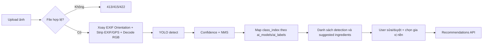

# Thiết kế phân hệ AI — Ingredient Object Detection

**Mã:** FV-AI-001 · **Trạng thái:** Proposed (`0.9.0-draft`) · **Nhiệm vụ:** object detection nhiều nguyên liệu trong 1 ảnh.

## 1. Vì sao dùng YOLO?

YOLO Object Detection cung cấp `class`/`confidence`/`bounding box` cho từng vật thể trong ảnh. Bài toán cần **nhiều nguyên liệu xuất hiện đồng thời** nên mô hình classification đơn nhãn không phù hợp. YOLO **chỉ nhận diện**, không được đặt món ăn hoặc tạo hướng dẫn chế biến. Recommendation Engine riêng sẽ xử lý món ăn từ dữ liệu structured.

**Mô hình cụ thể:** chọn biến thể YOLO sau khi so sánh bản nhỏ (ưu tiên inference CPU) và bản có chất lượng cao hơn nếu có GPU; không gắn cứng version chỉ vì xuất hiện trong tài liệu mẫu. Giấy phép Ultralytics cần được kiểm tra trước phát hành; xem [ADR-005](../07-decisions/ADR-005-yolo-licensing.md).

## 2. Dữ liệu vào/ra

- Input: một ảnh JPEG/PNG/WebP, kích thước file `<= 5 MiB`, xử lý tạm thời theo request, không lưu ảnh gốc bền vững; framework có thể dùng spool tạm và phải dọn sạch.
- Tiền xử lý bắt buộc trước suy luận: backend đọc cờ **EXIF Orientation** để xoay ảnh về đúng chiều hiển thị chuẩn (upright), xóa sạch toàn bộ metadata **EXIF/GPS** trong bộ nhớ, sau đó giải mã RGB và resize/letterbox theo model (xem [ADR-010](../07-decisions/ADR-010-image-exif-and-validation-errors.md)).
- Output raw từ model: `(class_index, confidence, bbox_xyxy)` trên nhiều object.
- Hậu xử lý: NMS và lọc theo confidence threshold **cấu hình theo model version**, quy đổi bbox về tọa độ **ảnh đã xoay chuẩn chiều hiển thị theo EXIF Orientation** rồi chuẩn hóa `[0, 1]`; tra `ai_labels(model_id, class_index)` để lấy `ingredient_id`.
- Output API: `detections[]` đầy đủ với từng box; `suggested_ingredients[]` khử trùng lặp theo mã nguyên liệu (chỉ gồm nguyên liệu chính `category != 'pantry'`), lấy `max_confidence` để UI hiển thị.
- **Không ước lượng gram** từ số box, kích thước box hay vật thể đơn lẻ; không thể suy ra khẩu phần chính xác từ ảnh bất kỳ.

## 3. Pipeline inference



### Quy tắc confidence

- Khởi điểm thử nghiệm `confidence_threshold=0.25`, không coi đây là ngưỡng tối ưu. Dùng validation set để tìm ngưỡng phù hợp giữa precision/recall.
- Bbox/detection có `ingredient_id=null` nếu phát hiện không ánh xạ được trong tình huống lỗi dữ liệu; ghi log và không tự đề xuất món từ nhãn thiếu ánh xạ.
- Trường hợp `detections=[]` sau inference thành công vẫn trả `HTTP 200`, hướng dẫn người dùng chuyển sang nhập tay tại chỗ.
- Chưa hỗ trợ tự động phân biệt tất cả nguyên liệu đã chế biến, bột, nước sốt, chất lỏng hoặc thịt đã cắt vụn; chỉ công bố lớp đã có bằng chứng chất lượng. Các gia vị nền gia dụng (`category = 'pantry'`) không đưa vào nhãn YOLO mà được chọn qua thanh bật/tắt gia vị sẵn có.

## 4. Mở rộng nhãn, versioning và rollback

Một class YOLO không phải primary key. Mỗi lần train dataset thay đổi lớp/thứ tự lớp phải tạo `ai_models.version` mới, đăng ký toàn bộ `(model_id, class_index, class_name, ingredient_id)` ở `ai_labels`. Có thể sử dụng lại `ingredient_id` khi tên nhãn class mới tương đương, nhưng không thay ID đã dùng trong công thức.

- **Ràng buộc ánh xạ nhãn (`BR-12`):** `ai_labels` chỉ được trỏ tới nguyên liệu có `is_active = true` và `category != 'pantry'`. Gán hoặc sửa nhãn trỏ tới nguyên liệu `pantry` hoặc `inactive` sẽ bị từ chối với `400 INVALID_LABEL_MAPPING`.
- **Tính bất biến (`BR-02`):** Chỉ cho phép thêm/sửa `ai_labels` khi model ở trạng thái `draft`. Model đang `active` hoặc `archived` là bất biến (`400 MODEL_IMMUTABLE`).
- **Kích hoạt và Rollback (`PATCH /api/v1/admin/ai-models/{model_id}/status`):**
  - Cho phép chuyển trạng thái từ `draft -> active` hoặc **rollback từ `archived -> active`**.
  - Trong cả hai chiều kích hoạt, backend kiểm tra trong cùng một giao dịch: (1) toàn bộ lớp của model đã được ánh xạ đầy đủ (`unmapped_class_indices = []`), và (2) tất cả các nguyên liệu được ánh xạ hiện đang có `is_active = true` và `category != 'pantry'` (`invalid_mapped_class_indices = []`). Nếu vi phạm bất kỳ điều kiện nào (ví dụ một nguyên liệu thuộc model `archived` đã bị đổi sang `pantry` hoặc tắt trong thời gian model đó lưu trữ), trả `400 MODEL_NOT_ACTIVATABLE`.
  - Khi hợp lệ, backend tự động chuyển model `active` hiện tại sang `archived` và kích hoạt model đích trong cùng một DB transaction, bảo đảm mọi thời điểm chỉ có tối đa 1 model `active`.

Ví dụ:

```text
Model food-yolo-v1: class=0, tomato -> ingredients.id(tomato)
Model food-yolo-v2: class=12, tomato -> cùng ingredients.id(tomato)
```

Quy trình: thêm ảnh + nhãn → gán nhãn và duyệt → train/eval → tạo model version draft → kiểm tra tất cả class mapping → benchmark → kích hoạt một model active (không cho sửa mappings của model active/archived) → giữ version cũ ở trạng thái `archived` để rollback khi cần. Không huấn luyện trực tiếp từ ảnh khách mà chưa có đồng ý, phân loại nhãn đúng và quyền sử dụng.

## 5. Giao diện và khả năng tự sửa

Frontend cần hiển thị: các hộp phát hiện (nếu có) trên ảnh đã xoay chuẩn chiều, tên + confidence, danh sách loại nguyên liệu chính gộp trùng, nút xóa/sửa/nhập tay và thanh bật/tắt gia vị sẵn có (`category = 'pantry'`). Xử lý thành công nghĩa là User **xác nhận danh sách cuối**, không phải AI đạt 100% accuracy. Bảng `scan_ingredients` chỉ lưu các nguyên liệu chính (`category != 'pantry'`) nếu User đã bật `save_history=true` và gửi danh sách đã xác nhận kèm `scan_id` qua API gợi ý.

## 6. Lỗi và vận hành

| Tình huống | Hành vi |
|---|---|
| File vượt quá 5 MiB | `413 IMAGE_TOO_LARGE`, không chạy model |
| Sai MIME type (không phải JPEG/PNG/WebP) | `415 UNSUPPORTED_IMAGE_TYPE`, không chạy model |
| File ảnh giả / hỏng / không decode được | `422 INVALID_IMAGE`, không chạy model |
| Không có đối tượng phát hiện | `200 OK` + `detections: []`, hiển thị nhập tay |
| Thời gian inference vượt ngưỡng timeout | Hủy tác vụ, trả `504 INFERENCE_TIMEOUT`, hướng dẫn thử lại hoặc nhập tay |
| Model không load / chưa có model active | `503 MODEL_NOT_READY` |
| Nhãn AI không tìm thấy mapping | Không gán `ingredient_id` bừa; log lỗi mapping |
| Hai bbox cùng loại | Giữ 2 bbox nếu hợp lệ, nhưng gộp `suggested_ingredients` theo mã chuẩn |

## 7. Checklist trước tích hợp

- [ ] Hoàn thành bảng nhãn được nhóm duyệt và nguồn dataset (không chứa `category = 'pantry'`).
- [ ] Có file `dataset.yaml` và manifest split train/val/test.
- [ ] Có trọng số model có quyền sử dụng, version, hash và log training.
- [ ] Có số liệu precision/recall/mAP theo từng lớp trên test độc lập (`AP50`, `Recall`, `N_test`).
- [ ] Đo latency p50/p95 và tài nguyên trên máy demo; kiểm chứng timeout `504 INFERENCE_TIMEOUT`.
- [ ] Kiểm chứng tiền xử lý tự xoay EXIF Orientation và xóa EXIF/GPS.
- [ ] Giao diện correction, empty prediction, manual fallback và thanh gia vị sẵn có hoạt động.

Tham khảo chính: https://docs.ultralytics.com/tasks/detect và https://docs.ultralytics.com/datasets/detect.
