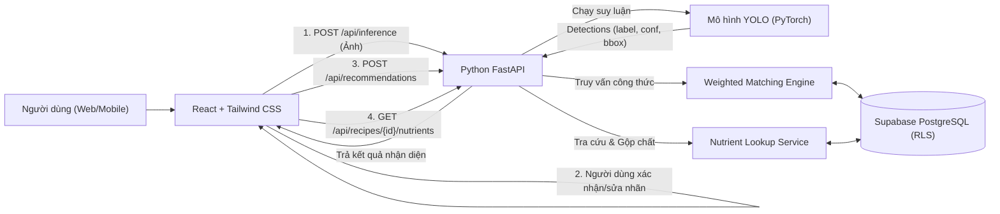
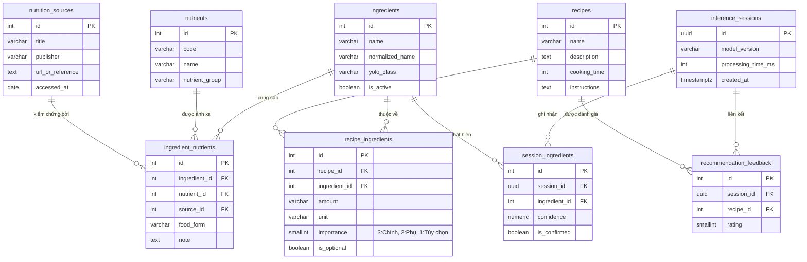

# Đặc Tả Kiến Trúc, Cơ Sở Dữ Liệu (ERD) & API Contract — FoodVision AI

## 1. Sơ Đồ Kiến Trúc Hệ Thống



---

## 2. Sơ Đồ Quan Hệ Thực Thể (ERD - 9 Bảng)



---

## 3. Đặc Tả Chi Tiết 6 Endpoints API (API Contract)

### 3.1. `POST /api/inference`
- **Đầu vào**: `multipart/form-data` chứa file ảnh (`JPG`, `PNG`, tối đa 10MB).
- **Đầu ra (`200 OK`)**:
```json
{
  "session_id": "a1b2c3d4-e5f6-7890-abcd-ef1234567890",
  "processing_time_ms": 145,
  "detections": [
    {
      "ingredient_id": 1,
      "yolo_class": "tomato",
      "name": "Cà chua",
      "confidence": 0.92,
      "bbox": [120, 85, 260, 210]
    },
    {
      "ingredient_id": 6,
      "yolo_class": "egg",
      "name": "Trứng gà (nguyên vỏ)",
      "confidence": 0.88,
      "bbox": [310, 110, 400, 220]
    }
  ],
  "unique_ingredients": [
    { "ingredient_id": 1, "name": "Cà chua", "yolo_class": "tomato" },
    { "ingredient_id": 6, "name": "Trứng gà (nguyên vỏ)", "yolo_class": "egg" }
  ]
}
```

### 3.2. `POST /api/recommendations`
- **Đầu vào (`application/json`)**:
```json
{
  "session_id": "a1b2c3d4-e5f6-7890-abcd-ef1234567890",
  "confirmed_ingredient_ids": [1, 6]
}
```
- **Công thức xếp hạng**:
  $$Score(I, R) = 100 \times \frac{\sum_{r \in I \cap R} w(r)}{\sum_{r \in R} w(r)}$$
  *(Phá hòa theo số lượng nguyên liệu chính còn thiếu ít hơn, sau đó đến thời gian chế biến ngắn hơn).*
- **Đầu ra (`200 OK`)**:
```json
{
  "top_recipes": [
    {
      "recipe_id": 1,
      "name": "Trứng xào cà chua (Canh trứng cà chua)",
      "cooking_time": 10,
      "score": 100.0,
      "matched_ingredients": [
        { "id": 6, "name": "Trứng gà (nguyên vỏ)", "importance": 3 },
        { "id": 1, "name": "Cà chua", "importance": 3 }
      ],
      "missing_ingredients": [],
      "optional_missing": [
        { "id": 11, "name": "Hành lá" }
      ]
    }
  ]
}
```

### 3.3. `GET /api/recipes/{id}`
- Trả về chi tiết công thức, danh sách nguyên liệu kèm định lượng tham khảo và các bước hướng dẫn chế biến.

### 3.4. `GET /api/recipes/{id}/nutrients`
- **Nguyên tắc**: Gộp danh sách chất dinh dưỡng từ các nguyên liệu của món ăn (không lặp lại tên chất), chỉ rõ nguyên liệu làm căn cứ và nguồn tham khảo. Nếu một nguyên liệu chưa có hồ sơ dinh dưỡng, đưa vào danh sách `unmapped_ingredients` với thông báo `"Chưa có dữ liệu đáng tin cậy"`.
- **Đầu ra (`200 OK`)**:
```json
{
  "recipe_id": 1,
  "recipe_name": "Trứng xào cà chua (Canh trứng cà chua)",
  "disclaimer": "Thông tin dinh dưỡng mang tính chất định tính tham khảo dựa trên thành phần nguyên liệu chuẩn, không phải phép đo định lượng (kcal/gram) từ hình ảnh.",
  "nutrients": [
    {
      "nutrient_id": 1,
      "code": "PROTEIN",
      "name": "Protein (Chất đạm)",
      "group": "Chất đa lượng",
      "display_statement": "Có thể cung cấp Protein (Chất đạm)",
      "derived_from_ingredients": [
        {
          "ingredient_id": 6,
          "ingredient_name": "Trứng gà (nguyên vỏ)",
          "food_form": "trứng gà nguyên quả",
          "source": "Bảng thành phần thực phẩm Việt Nam (Viện Dinh dưỡng Quốc gia - Bộ Y tế)"
        }
      ]
    }
  ],
  "unmapped_ingredients": []
}
```

### 3.5. `GET /api/ingredients`
- Trả về toàn bộ danh mục nguyên liệu đang kích hoạt để người dùng tìm kiếm/thêm thủ công ở bước xác nhận.

### 3.6. `POST /api/feedback` *(Mở rộng)*
- Ghi nhận đánh giá gợi ý hữu ích (`1`) hoặc không hữu ích (`-1`).

